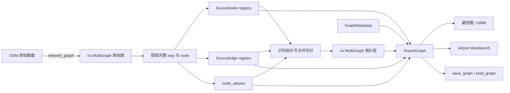
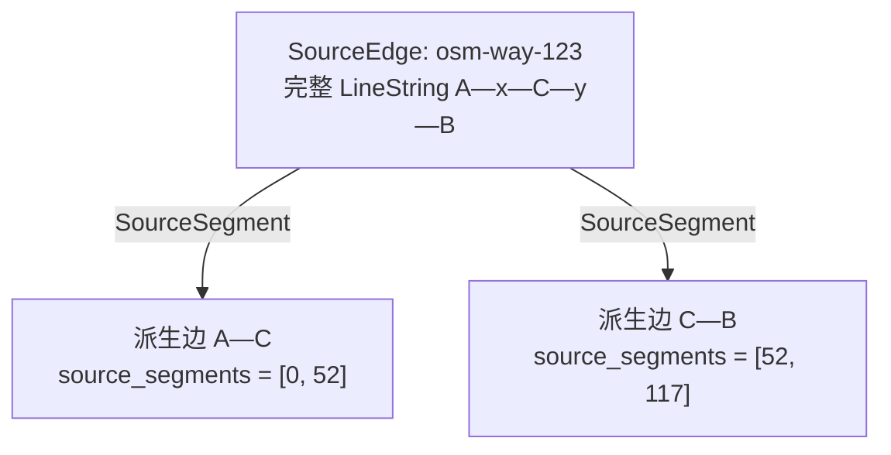
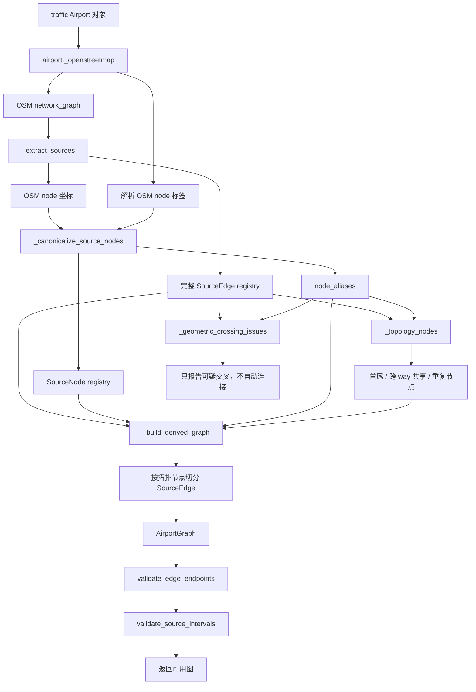

# `airport_surface` 模块说明

## 1. 模块解决什么问题

`airport_surface` 负责把机场 OSM 道路数据转换成适合路径搜索和地图匹配的无向拓扑图，同时永久保留构图前的完整 OSM 来源。

它需要同时满足两类需求：

1. **算法需要简洁的拓扑图**：NetworkX 图中只保留真正影响连通关系的节点和边，供最短路、HMM map matching 等算法使用。
2. **人工校图需要权威来源**：即使一条 OSM 道路被切成多个图边，原始完整 LineString、OSM way ID 和内部 OSM node 仍然存在，可以用于检查、恢复和重新切分。

因此，模块没有把“OSM 原始道路”和“用于路由的图边”混成同一种对象，而是明确分成两层：

- **来源层**：`SourceNode`、`SourceEdge`，保存完整且稳定的 OSM 信息；
- **拓扑层**：`nx.MultiGraph`，保存供算法使用的图节点和派生边。

`AirportGraph` 是这两层数据的总容器，并提供坐标投影、来源查询和复制等辅助能力。

> 这里的 `AirportGraph` 是本项目自己的类，不是 `traffic.algorithms.ground.graphs.AirportGraph`。

---

## 2. 模块文件组织

```text
src/airport_surface/
├── __init__.py       # 对外公开接口，以及 Workbench 兼容入口
├── models.py         # AirportGraph、SourceNode、SourceEdge、NodeMergeGroup 等
├── graph.py          # 构图、校验、来源区间重建、保存和加载
├── editor.py         # 指向 airport_workbench 的兼容导入
├── editor_app.py     # 指向 airport_workbench Web 应用的兼容导入
└── __main__.py       # python -m airport_surface 的兼容启动入口
```

日常理解和维护主要关注两个文件：

- `models.py`：数据是什么；
- `graph.py`：数据如何生成、校验和持久化。

Workbench 的实际编辑逻辑已经放在独立的 `airport_workbench` 模块中。`airport_surface` 只保留兼容入口，避免旧调用立即失效。

### 对外公开接口

`airport_surface.__init__` 公开的主要名称如下：

| 名称 | 作用 |
|---|---|
| `AirportGraph` | 项目自有的机场图总容器。 |
| `SourceNode` / `SourceEdge` | 不可变的原始来源记录。 |
| `NodeMergeGroup` | 一次经过人工确认的近距离节点等价关系。 |
| `NodeSnapRecord` | 一次用户明确选择节点和目标边的人工吸附记录。 |
| `SourceSegment` | 一条图边所使用的某个 SourceEdge 米制区间及遍历方向。 |
| `GraphMetadata` | 机场标识与构图问题。 |
| `build_airport_graph(airport)` | 从指定 traffic `Airport` 构图。 |
| `build_graph()` | 从 `traffic.data.airports["ZBAA"]` 构建 ZBAA。 |
| `build_zbaa_graph()` | `build_graph()` 的别名。 |
| `save_graph()` / `load_graph()` | 将完整双层数据保存为 JSON 或恢复。 |
| `validate_edge_endpoints()` | 校验派生边 geometry 与无向拓扑端点。 |
| `validate_source_intervals()` | 校验派生区间是否完整、连续覆盖来源。 |
| `source_registry(graph)` | 返回 `graph.source_edges`，主要是兼容性辅助函数。 |
| `geometry_from_source_segments()` | 从有序来源链重建图边曲线。 |
| `edit_graph()` | 延迟导入并调用 `airport_workbench.edit_graph()`。 |

---

## 3. 整体数据关系



一个 `SourceEdge` 可以生成多条派生图边：



这里 `x`、`y` 可以只是决定道路曲线形状的内部 OSM node，不一定成为 NetworkX 图节点；`C` 如果被多条 way 共享，则会成为拓扑节点和切分点。

---

## 4. 重要数据结构

### 4.1 `SourceNode`

定义位置：`src/airport_surface/models.py`

语义：一个规范化后的 OSM 来源节点。坐标完全相同的多个 OSM node 会合并成一个 `SourceNode`，其他 ID 通过 `node_aliases` 指向它。

```python
@dataclass(frozen=True, slots=True)
class SourceNode:
    node_id: Hashable
    position: tuple[float, float]
    osm_node_ids: tuple[Hashable, ...]
    attributes: Mapping[str, Any]
```

| 字段 | 含义 |
|---|---|
| `node_id` | 规范节点 ID。通常采用同坐标分组中遇到的第一个 OSM node ID。 |
| `position` | WGS84 坐标 `(longitude, latitude)`。 |
| `osm_node_ids` | 这个规范节点代表的全部同坐标 OSM node ID。没有重复时通常只有一个。 |
| `attributes` | OSM node 的附加标签。目前内部通常保存为 `osm_node_attributes`。 |

`SourceNode` 是 frozen dataclass，字段不能重新赋值；传入的属性字典会被深拷贝并包装成只读 mapping。

注意：`source_nodes` 包含完整来源中的节点，而 `airport_graph.graph.nodes` 只包含参与拓扑的那部分节点。两者数量通常不同。

### 4.2 `SourceEdge`

语义：一条未切分、不可变的完整来源道路。对于 OSM 数据，一般对应 `network_graph()` 返回的一条完整 way；人工来源也可以拥有自己的 `SourceEdge`。

```python
@dataclass(frozen=True, slots=True)
class SourceEdge:
    source_id: str
    geometry: BaseGeometry
    source_type: str
    osm_way_id: Any = None
    osm_node_ids: tuple[Hashable, ...] = ()
    attributes: Mapping[str, Any]
```

| 字段 | 含义 |
|---|---|
| `source_id` | 项目内部稳定的来源标识，例如 `osm-way-123`。派生边通过它反查完整来源。 |
| `geometry` | 完整、未切分的 WGS84 LineString。切分和人工修复都不应修改它。 |
| `source_type` | 来源类型，目前主要为 `osm`，人工来源可用 `manual`。 |
| `osm_way_id` | 原始 OSM way ID；人工来源可以是 `None`。 |
| `osm_node_ids` | 按 LineString 坐标顺序排列的全部 OSM node ID，包括普通内部形状点。 |
| `attributes` | way 的业务属性，例如 `aeroway`、`ref`、`name`、`parking_position`。 |

关键约定：

- `SourceEdge.geometry` 保存完整原始曲线，不能因为派生边切分、删除或重建而改变；
- 派生边保存有序 `source_segments`，不重复保存完整来源 LineString；
- `SourceEdge` 对象不可修改，但 `AirportGraph.source_edges` 容器本身是普通字典，应由业务代码谨慎管理。

### 4.3 `SourceSegment`

`SourceSegment` 表示一条图边使用的某段不可变来源：

```python
@dataclass(frozen=True, slots=True)
class SourceSegment:
    source_id: str
    source_start_m: float
    source_end_m: float
    reversed: bool = False
```

`source_start_m < source_end_m` 始终成立；`reversed=True` 表示图边按来源的反方向遍历该区间。
一条图边可以有多个有序 SourceSegment，因此人工简化后可以跨越多个 SourceEdge，仍然能完整重建原始曲线。

`edge_source_segments(edge_data)` 是统一读取入口：新边直接返回来源链；当前旧数据中只有
`source_id/source_start_m/source_end_m` 时，会在内存中自动规范化为单元素来源链。

### 4.4 `GraphMetadata`

```python
@dataclass(frozen=True, slots=True)
class GraphMetadata:
    airport: str = "ZBAA"
    build_issues: tuple[str, ...] = ()
```

| 字段 | 含义 |
|---|---|
| `airport` | 机场 ICAO 代码。 |
| `build_issues` | 构图时发现但没有擅自修复的问题，例如几何相交却没有共享 OSM node。 |

该模块不再管理图格式版本，也不会根据版本号拒绝加载文件。

### 4.5 `AirportGraph`

`AirportGraph` 是整个模块的核心容器：

```python
AirportGraph(
    graph,
    projection,
    source_nodes=...,
    source_edges=...,
    node_aliases=...,
    metadata=...,
)
```

| 属性 | 含义 |
|---|---|
| `graph` | 无向 `networkx.MultiGraph`，供路径搜索和 map matching 使用。 |
| `projection` | 米制投影。ZBAA 自动构图使用 UTM zone 50，保存和加载会保留实际投影。 |
| `project` | WGS84 → 米制投影的 `Transformer`。 |
| `to_wgs84` | 米制投影 → WGS84 的 `Transformer`。 |
| `source_nodes` | `{canonical_node_id: SourceNode}` 来源节点注册表。 |
| `source_edges` | `{source_id: SourceEdge}` 完整来源边注册表。 |
| `node_aliases` | `{alias_osm_id: canonical_node_id}` 同坐标重复节点映射。 |
| `node_merge_groups` | `{canonical_node_id: NodeMergeGroup}` 人工节点合并记录。 |
| `node_snap_records` | 人工吸附历史，保存原坐标、投影坐标、目标来源和移动距离。 |
| `metadata` | `GraphMetadata`。 |

主要方法：

| 方法 | 作用 |
|---|---|
| `components` | 返回每个连通分量的节点数，例如 `[1900, 12]`。 |
| `project_shape(geometry)` | 将 WGS84 Shapely geometry 投影到米制坐标。 |
| `to_wgs84_shape(geometry)` | 将投影 geometry 转回 WGS84。 |
| `length(geometry)` | 以米计算 WGS84 geometry 的长度。 |
| `canonical_node_id(node_id)` | 把重复节点别名转换成规范 ID。 |
| `get_source_node(node_id)` | 支持用规范 ID 或别名获取 `SourceNode`。 |
| `get_source_edge(source_id)` | 获取完整 `SourceEdge`。 |
| `derived_edges(source_id)` | 查找来源链中包含该 SourceEdge 的全部派生图边。 |
| `copy()` | 深拷贝拓扑图，保留来源注册表和元数据。 |

### 4.6 NetworkX 图节点

`airport_graph.graph` 是无向 `MultiGraph`。图节点不是全部 OSM node，只包括：

1. 每条 SourceEdge 的首尾节点；
2. 被不同 SourceEdge 共享的 OSM node；
3. 在同一来源节点序列中重复出现、会影响拓扑的 node；
4. 后续通过 Workbench 明确加入的人工拓扑节点。

自动构图产生的图节点至少具有：

```python
{
    "pos": (longitude, latitude),
    "source_type": "osm",
    "osm_node_ids": (...),
}
```

`pos` 始终是 WGS84 经纬度。需要计算米制距离时必须通过 `AirportGraph.project` 或 `project_shape()`，不能直接对经纬度做欧氏距离。

### 4.7 NetworkX 派生边

每条派生边由一个或多个有序 `SourceSegment` 组成。自动构图产生单来源边；Workbench 人工删点简化
可以把多条边拼接为跨来源的复合边。

关键字段：

| 字段 | 含义 |
|---|---|
| `geometry` | 当前派生片段的 WGS84 LineString。 |
| `first` / `last` | 按来源 LineString 方向记录的两个拓扑端点。 |
| `source_segments` | 权威的有序来源链，可以包含多个 SourceEdge 区间。 |
| `source_id/start/end` | 为当前单来源数据保留的兼容字段；复合边不伪造单一 `source_id`。 |
| `source_type` | 单来源边继承来源类型，跨来源边为 `composite`。 |
| `osm_node_ids` | 该片段覆盖的局部 OSM node 序列。 |
| 其他属性 | 从 SourceEdge 继承的 `aeroway`、`ref`、`name` 等。 |

因为图是无向图，NetworkX 返回的 `(u, v)` 顺序不稳定。`first/last` 用来表达来源几何方向，不能假设 `u == first`、`v == last`。

必须满足的端点不变量是：

```text
{geometry 首端点, geometry 尾端点}
    与
{node[u].pos, node[v].pos}
在米制容差内一一对应
```

允许 geometry 坐标顺序与 NetworkX 的 `u/v` 顺序相反。

---

## 5. 自动构图主流程

入口：

```python
build_airport_graph(airport)
```

ZBAA 快捷入口：

```python
build_graph()
build_zbaa_graph()  # build_graph 的别名
```

完整流程如下：



### 第一步：获取 OSM 原始图

`build_airport_graph()` 调用 `traffic` 的 OSM 读取能力：

```python
raw_graph = osm.network_graph(
    "geometry",
    "aeroway",
    "parking_position",
    "ref",
    "name",
    "id_",
    "nodes",
    query_str='aeroway == "taxiway" or aeroway == "runway" or aeroway == "parking_position"',
)
```

此时只借助 traffic 获取 OSM 数据，不使用 traffic 的 `AirportGraph.from_airport()` 或其自动吸附修图流程。

### 第二步：建立不可变来源层

`_extract_sources()` 把原始图的每条边转换为完整 `SourceEdge`，并检查：

- geometry 必须是非空 LineString；
- `nodes` 数量必须与 LineString 坐标数量一致；
- 同一个 OSM node ID 不能对应互相矛盾的坐标。

不合格的来源不会被猜测修复，而是记录到 `build_issues`。

### 第三步：合并坐标完全相同的来源节点

`_canonicalize_source_nodes()` 以完全相同的 `(longitude, latitude)` 分组：

```text
OSM node 3 ─┐
            ├─> SourceNode(node_id=3, osm_node_ids=(3, 8))
OSM node 8 ─┘

node_aliases[8] = 3
```

这不是“附近吸附”，只处理坐标完全相同的节点。

### 第四步：识别真正的拓扑节点

`_topology_nodes()` 只选择有拓扑意义的 OSM node：

- way 首尾节点；
- 出现在多个 SourceEdge 中的共享 node；
- 在同一来源序列中重复出现的 node。

普通内部 OSM node 留在 `SourceEdge.osm_node_ids` 和 LineString 中，用于表达曲线形状，但不会让 NetworkX 图无意义地膨胀。

### 第五步：报告纯几何交叉

`_geometric_crossing_issues()` 使用空间索引检查 SourceEdge 的几何相交。

如果两条道路几何相交，却没有共享 OSM node，系统只把问题写入 `metadata.build_issues`，不会自动建立连接。这样可以避免平行道路、桥接关系或错误几何造成严重拓扑污染。

### 第六步：按照 OSM node 身份切分

`_build_derived_graph()` 在前面识别出的拓扑节点位置切分完整来源。每个派生片段记录：

- 对应的 `source_id`；
- 在完整来源上的 `[source_start_m, source_end_m]`；
- 该区间内的局部 `osm_node_ids`；
- 从来源继承的道路属性。

同时会写入单元素 `source_segments`。这保证自动构图与复合来源模型统一，但不会在构图时自动简化任何节点。

自动构图没有 18 米吸附，也没有 0.5 米自动吸附。一个附近节点不会因为“离道路很近”就被投影到道路上。自动连通关系只由 OSM node 身份和完全相同坐标的别名提供证据。

### 第七步：校验

构图结束后依次执行：

```python
validate_edge_endpoints(graph)
validate_source_intervals(graph)
```

校验通过才返回 `AirportGraph`。

---

## 6. 来源区间与几何重建

### `geometry_from_source_interval()`

```python
geometry = geometry_from_source_interval(
    airport_graph,
    source_id="osm-way-123",
    start_m=20.0,
    end_m=65.0,
    start_node=node_a,
    end_node=node_b,
)
```

工作过程：

1. 获取完整 `SourceEdge.geometry`；
2. 投影到米制坐标；
3. 使用 Shapely `substring()` 截取给定累计距离区间；
4. 如提供拓扑端点，令片段首尾精确落到对应 `node.pos`；
5. 转回 WGS84 LineString。

Workbench 的恢复连接、切分后重建和删点合并都应以这个思想为基础，而不是用两个节点坐标画直线。

### `source_boundaries()`

返回某个来源当前所有派生片段的边界：

```python
[(0.0, node_a), (52.0, node_c), (117.0, node_b)]
```

### `rebuild_source_edges()`

删除某个 `source_id` 当前生成的所有派生边，再按照给定边界从完整来源重新生成。它会改变拓扑层，不修改 `SourceEdge`。

这两个函数目前是模块内部能力，没有从 `airport_surface.__init__` 公开导出。

### `geometry_from_source_segments()`

按顺序截取每个 SourceSegment，根据 `reversed` 调整方向，校验相邻片段在投影坐标下连续，再拼接成完整 LineString。

Workbench 人工节点简化只能通过这类来源链重建曲线，不能使用两个外部节点画直线。

---

## 7. 校验函数

### `validate_edge_endpoints()`

检查每条派生边的 geometry 两端是否分别匹配无向拓扑端点 `{u, v}`。

```python
validate_edge_endpoints(airport_graph)
```

- 默认容差：`0.001 m`；
- 使用 `AirportGraph` 的投影坐标计算；
- 允许 geometry 与 `(u, v)` 方向相反；
- geometry 缺失、为空或端点不匹配会抛出 `ValueError`。

### `validate_source_intervals()`

检查每个 SourceEdge 的全部派生区间能否连续、无缺口、无重叠地覆盖完整来源。

```python
validate_source_intervals(airport_graph)
```

需要注意：Workbench 允许用户故意删除派生边来表达“当前拓扑不连接”。这种图可能有来源区间缺口，此时 `validate_source_intervals()` 会按设计报错。它适合验证刚自动构建完成、理论上应完整覆盖来源的图，而不一定适合每一种人工编辑状态。

### `validate_edge_sources()`

验证每条图边的来源链：

- 每个 `source_id` 存在；
- 区间没有超出 SourceEdge；
- 相邻片段在米制坐标下连续；
- 从来源链重建的 geometry 与图边保存的 geometry 一致。

---

## 8. 保存和加载

### 保存

```python
from airport_surface import save_graph

save_graph(graph)
save_graph(graph, "data/graphs/my_airport.json")
```

默认路径：

```text
data/graphs/zbaa_final.json
```

顶层数据包括：

```text
airport
projection
build_issues
source_nodes
node_aliases
node_merge_groups
node_snap_records
source_edges
nodes
edges
```

保存采用临时文件加替换的方式：先写 `*.json.tmp`，成功后再替换正式文件，降低写到一半损坏正式文件的风险。

### 加载

```python
from airport_surface import load_graph

graph = load_graph()
graph = load_graph("data/graphs/my_airport.json")
```

加载会恢复：

- NetworkX MultiGraph；
- Shapely geometry；
- SourceNode / SourceEdge registry；
- node aliases；
- 人工节点合并记录（旧文件缺少该字段时按空注册表读取）；
- 人工吸附记录（旧文件缺少该字段时按空列表读取）；
- metadata；
- 文件中保存的米制投影工具。

当前实现不校验格式版本号，而是直接按当前字段结构解析。缺失必要的 `nodes`、`edges` 或字段类型不正确时，会自然抛出 `KeyError`、类型错误或 JSON 解析错误。

旧的单来源边会在加载到 `AirportGraph` 时自动规范化为单元素来源链，无需重新构图。新文件保存实际投影定义，
`load_graph()` 会恢复该投影；仍兼容旧文件的 `UTM zone 50` 文本。

---

## 9. 常用使用方法

### 9.1 从 OSM 构建 ZBAA 图

```python
from airport_surface import build_graph

graph = build_graph()

print(graph.graph.number_of_nodes())
print(graph.graph.number_of_edges())
print(graph.components)
print(graph.metadata.build_issues)
```

### 9.2 保存并重新加载

```python
from airport_surface import build_graph, load_graph, save_graph

graph = build_graph()
save_graph(graph, "data/graphs/zbaa.json")

loaded = load_graph("data/graphs/zbaa.json")
```

### 9.3 查看某条派生边的完整来源

```python
from airport_surface import edge_source_segments

u, v, key, edge = next(iter(graph.graph.edges(keys=True, data=True)))

segments = edge_source_segments(edge)

print("拓扑端点:", u, v)
for segment in segments:
    source = graph.get_source_edge(segment.source_id)
    print("来源:", segment.source_id, source.osm_way_id)
    print("区间:", segment.source_start_m, segment.source_end_m, segment.reversed)
```

### 9.4 处理重复 OSM node

```python
canonical = graph.canonical_node_id(osm_node_id)
source_node = graph.get_source_node(osm_node_id)

print(canonical)
print(source_node.osm_node_ids)
```

### 9.5 执行完整端点校验

```python
from airport_surface import validate_edge_endpoints

validate_edge_endpoints(graph)
```

### 9.6 打开 Workbench

```python
from airport_surface import edit_graph, load_graph

graph = load_graph("data/graphs/zbaa.json")
edited_graph = edit_graph(graph, save_path="data/graphs/zbaa.json")
```

`edit_graph()` 是兼容包装，实际调用 `airport_workbench.edit_graph()`。Workbench 对拓扑层的编辑应保留来源层，并使用有序 `source_segments` 重建曲线。节点简化只能人工发起，自动构图和加载不会自动执行。

Workbench 当前提供以下来源感知操作：

- 选择节点时，同时高亮其关联边和相邻节点；搜索结果直接进入同一选中状态；
- “恢复连接”可沿原始 OSM node 网络跨多个 `SourceEdge` 搜索受限候选，并用组合
  `SourceSegment` 重建曲线；
- 删除节点时，同源半边默认配对，未参与任何配对的半边会阻止删除；一条半边可以参与多组人工连接；
- “合并节点”只检查 0.5 米内的现有 NetworkX 图节点，也允许连续点选；内部 OSM Node
  不进入候选且不能通过该工具合并；任何候选都必须人工预览和确认；
- 人工合并会重接全部关联边、重建派生 geometry，并记录
  `NodeMergeGroup`，不会修改完整 `SourceEdge`；
- “人工吸附”要求用户先选图节点、再选目标派生边；确认后将图节点移动到目标
  `SourceEdge` 的投影位置，重建节点原有关联边并切分目标边，记录 `NodeSnapRecord`；
  该功能不扫描附近节点，也不会自动执行；
- 普通编辑只校验受影响的边以保持交互速度，保存时执行完整端点和来源校验。

人工合并默认候选距离为 0.5 米，硬性上限为 2 米。候选距离只用于发现，不会触发自动合并。

#### 只读可视化

仅查看机场图、ADS-B 轨迹或匹配路径时，应使用 `airport_workbench.visualize_graph()`，
而不是打开完整编辑器：

```python
from airport_surface import load_graph
from airport_workbench import visualize_graph

graph = load_graph("data/graphs/zbaa.json")
visualize_graph(graph, flights=[flight], paths=[matched_path])
```

只读模式复用 Workbench 的地图图层、节点/边详情、搜索、拓扑检查、连通分量定位、
平行边定位和相邻边辨色功能。它不会显示编辑工具、保存、撤销或完成按钮；服务端也会
拒绝所有写请求，因此不会修改传入的 `AirportGraph` 或磁盘文件。

也可以通过命令行脚本打开已有机场图：

```powershell
uv run python scripts/visualize_airport_graph.py `
    --input data/graphs/zbaa_final.json
```

可选参数包括 `--host`、`--port` 和 `--no-browser`。

### 9.7 访问底层 NetworkX API

```python
import networkx as nx

nx_graph = graph.graph
path_nodes = nx.shortest_path(nx_graph, source=start, target=end)
```

这个例子是不加权的拓扑最短路。如果要按米制长度加权，应根据每条边的 `geometry` 通过
`AirportGraph.length()` 计算或维护明确的长度属性。本模块不包装 NetworkX 的全部算法；路径搜索
直接针对 `AirportGraph.graph` 进行。

---

## 10. 关键设计规则

维护该模块时，应始终遵守以下规则：

1. **来源和拓扑分离**：删除或重建派生边，不等于删除 `SourceEdge`。
2. **SourceEdge 始终完整**：不能用切分后的片段覆盖完整来源 geometry。
3. **禁止距离自动造拓扑**：附近不等于相连；自动构图只相信 OSM node 身份和精确同坐标别名。
4. **派生边必须可追溯**：应保存有序 `source_segments`；单来源时可保留旧标量字段作为兼容信息。
5. **曲线从来源恢复**：不要用节点之间的直线代替原始 LineString。
6. **图是无向 MultiGraph**：允许平行边，不依赖 NetworkX 返回的 `u/v` 顺序表达几何方向。
7. **距离必须以米计算**：先投影，再计算距离、长度和容差。
8. **拓扑端点与 geometry 一致**：任何编辑后都应满足无向端点不变量。
9. **可疑交叉只报告**：没有共享 OSM node 的几何交叉不能被自动连接。
10. **内部形状点不等于拓扑节点**：只有影响连通关系的 OSM node 才进入 NetworkX 图。

---

## 11. 阅读代码的推荐顺序

如果需要继续深入阅读源码，推荐按以下顺序：

1. `models.py` 中的 `SourceNode`、`SourceEdge`；
2. `models.py` 中的 `AirportGraph`；
3. `graph.py::_extract_sources()`；
4. `graph.py::_canonicalize_source_nodes()`；
5. `graph.py::_topology_nodes()`；
6. `graph.py::_build_derived_graph()`；
7. `graph.py::build_airport_graph()`；
8. 两个校验函数；
9. `save_graph()` 和 `load_graph()`；
10. 最后再阅读 `airport_workbench.editor.EditorSession`，理解人工编辑如何利用来源层。

一句话概括主逻辑：

> 从 OSM 提取不可变的完整道路来源，只在有明确 OSM node 证据的位置建立拓扑和切分，再用有序 `SourceSegment` 链把每条 NetworkX 派生边永久关联回一个或多个原始曲线区间。
