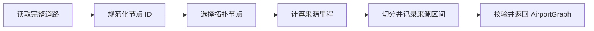

# AirportGraph：一张机场道路图是怎样建成的

AirportGraph 用来回答两类问题：**飞机可以沿哪些道路走到哪里，以及图中的道路来自哪份原始数据。** 前一个问题交给节点和边组成的网络，后一个问题交给保留下来的完整 OSM 道路。AirportGraph 把两者放在同一个对象中，并保存计算距离所需的坐标投影。

本文用一组简单道路说明它的数据定义和构建过程，再解释源码中的对应实现。启动命令、文件路径参数和编辑操作见 [建图与修复说明](graph_build_and_repair.md)，不在这里重复。

## 1. 先看建图前后有什么变化

假设 OSM 提供了两条道路。道路 W1 经过 A、x、C、y、B，道路 W2 经过 D、C、E。这里的 C 是两条道路共同引用的同一个 OSM 节点；x、y 只用于描述道路形状。

```text
                  E
                  │
W1：A ── x ─────── C ─────── y ── B
                  │
                  D
                 W2
```

为了让数字容易核对，例子使用直线道路和局部米制坐标：

| 点 | 坐标（米） | 在原始道路中的作用 |
|---|---|---|
| A | (0, 0) | W1 起点 |
| x | (20, 0) | W1 内部形状点 |
| C | (60, 0) | 两条道路共享的交点 |
| y | (80, 0) | W1 内部形状点 |
| B | (100, 0) | W1 终点 |
| D | (60, -40) | W2 起点 |
| E | (60, 40) | W2 终点 |

真实数据保存的是经纬度，这里的米制坐标只用于讲解。

构建完成后，用于搜索路径的图有 **5 个节点、4 条边**：

```text
节点：A、B、C、D、E
边：A—C、C—B、D—C、C—E
```

x、y 没有成为图节点，因为它们不提供道路分叉；但它们没有丢失，仍分别保存在 A—C、C—B 的曲线坐标中。真实道路弯曲时，中间坐标同样保留，不能把整段道路直接拉成端点之间的直线。

与此同时，完整 W1 和 W2 仍单独保存。图边 A—C 记录自己来自 W1 的第 0～60 米，C—B 来自 W1 的第 60～100 米。这样，图可以简洁，同时仍有完整的来源依据。

## 2. 这个例子在内存里怎样保存

AirportGraph 不是只有一张 NetworkX 图，它包含下列几部分。这里的“注册表”就是按 ID 查找对象的字典。

```text
AirportGraph
├── graph                 用于搜索路径的节点与边
├── source_nodes          原始节点的记录
├── source_edges          完整原始道路的记录
├── node_aliases          不同原始节点 ID 对应同一位置时的别名
├── projection            计算米制距离的投影
├── metadata              机场标识、构图时发现的问题
├── node_merge_groups     后续人工合并节点的记录
└── node_snap_records     后续人工移动节点接入道路的记录
```

### 2.1 SourceNode：保留原始节点信息

例子中的 A、x、C、y、B、D、E 都有来源节点记录，即使 x、y 不进入最终的路由图。

| 字段 | 保存什么 |
|---|---|
| `node_id` | 该来源节点采用的规范 ID。没有别名时就是原始 ID。 |
| `position` | 经度、纬度。 |
| `osm_node_ids` | 它代表的全部原始 ID，通常只有一个。 |
| `attributes` | 原始节点的附加标签。 |

如果两个不同 ID 的坐标完全相同，构图代码会选先遇到的 ID 作为规范 ID，另一 ID 写入 `node_aliases`。之后判断道路是否共享节点时，先转换为规范 ID。仅仅相距很近不会合并。

### 2.2 SourceEdge：保留完整原始道路

W1 对应一个 SourceEdge，其 geometry 仍然经过 A、x、C、y、B；它不会因为 C 处发生切分而变成半条道路。

| 字段 | 保存什么 |
|---|---|
| `source_id` | 本图中查找这条来源的键，例如 `osm-way-101`。 |
| `geometry` | 完整道路曲线，坐标为 WGS84 经纬度。 |
| `source_type` | 来源类型，自动构图为 `osm`。 |
| `osm_way_id` | 原始 OSM way ID。 |
| `osm_node_ids` | 与曲线坐标对应的全部原始节点 ID，保留顺序。 |
| `attributes` | `aeroway`、`ref`、`name` 等道路标签。 |

来源键优先根据 way ID 生成，重名时添加数字后缀；它用于本图内部关联，不是跨所有数据版本通用的道路身份证。

### 2.3 graph：真正用于路由的图

`graph` 是无向 `networkx.MultiGraph`。无向表示道路在此模型中没有单行限制；MultiGraph 表示同一对节点之间可以存在多条不同道路。

一条图边由 `(u, v, key)` 标识。u、v 是端点，key 区分相同端点之间的多条边，不能只凭两个节点就确定道路。

图节点的主要字段是 `pos`。图边保存以下信息：

| 字段 | 以 A—C 为例 |
|---|---|
| `geometry` | A、x、C 的坐标序列。 |
| `first` / `last` | 曲线坐标顺序对应的 A、C。 |
| `source_segments` | W1 的第 0～60 米。 |
| 道路属性 | 从 W1 继承的名称、道路类型等。 |

无向图枚举边时可能返回 `(C, A, key)`，但这不会改变 geometry 原本的坐标顺序。`first/last` 记录的是曲线方向，不能用 NetworkX 枚举顺序替代。

### 2.4 SourceSegment：说明图边取自原道路的哪一段

SourceSegment 本身不复制曲线，只保存“来源 ID＋起止里程＋遍历方向”。里程从完整来源曲线的第一个坐标开始，沿曲线累加，以米为单位。

| 图边 | `source_id` | `source_start_m` | `source_end_m` | `reversed` |
|---|---|---:|---:|---|
| A—C | W1 的来源键 | 0 | 60 | false |
| C—B | W1 的来源键 | 60 | 100 | false |
| D—C | W2 的来源键 | 0 | 40 | false |
| C—E | W2 的来源键 | 40 | 80 | false |

`reversed=true` 表示按结束里程向起始里程走，起止数值仍按小到大保存。构造器拒绝负起点或终点不大于起点的区间。

为什么 `source_segments` 是一个序列，而不是单个字段？因为后续可能将 A—C 和 C—E 合并为一条 A—E 边。这条边依次使用 W1 的 0～60 米、W2 的 40～80 米，需要两个区间才能解释它的完整曲线。自动构图不会执行这种人工简化。

旧单来源字段 `source_id/source_start_m/source_end_m` 仍可读入；初始化时会转换成单元素来源序列。新的逻辑应以来源序列为准。

## 3. 构建过程：怎样从 W1、W2 得到四条边

### 第一步：读出原始道路及节点

`traffic_builder.py` 获取机场 OSM 数据中的滑行道、跑道和机位道路。它借助 traffic 读取数据，但不用 traffic 的 AirportGraph 自动修图流程。

`_extract_sources()` 为每条原始道路建立 SourceEdge，并收集节点坐标。每个原始节点必须能够与曲线中的一个坐标对应，否则无法知道应当在哪里切分。

空曲线、非 LineString、节点数与坐标数不一致的来源会记录问题并跳过。同一个节点 ID 出现矛盾坐标时，当前代码保留首次坐标并记录问题，后续校验还可能失败；它不会猜测哪个坐标正确。

### 第二步：统一完全同坐标的节点 ID

`_canonicalize_source_nodes()` 生成 SourceNode 和别名表。例子中没有重复坐标，所以全部原始 ID 保持不变。

如果 W2 使用另一个 ID C2，但 C2 与 C 的经纬度完全相同，别名机制可以使它们参与同一拓扑连接。如果只是接近 C，则不会自动连接。

### 第三步：决定哪些点必须成为图节点

`_topology_nodes()` 选择以下节点的并集：

1. 每条来源道路的首尾点：例子中的 A、B、D、E。
2. 被不同来源共享的点：例子中的 C。
3. 在同一来源序列中重复出现的点：用于保留回到同一点等结构，本例没有。

因此结果是 A、B、C、D、E。x、y 只保留为曲线形状点。

**几何上画出了交叉，不一定代表图上相连。** 若两条道路没有共享原始节点或精确同坐标别名，代码只记录可疑交叉，不凭线条相交就自动加连接。这避免把不应连通的道路连在一起。

### 第四步：计算每个坐标在来源道路上的里程

`_cumulative_distances()` 将完整道路投影到米制坐标，逐段计算长度并累加。本例 W1 的结果为：

| 点 | A | x | C | y | B |
|---|---:|---:|---:|---:|---:|
| 累计里程（米） | 0 | 20 | 60 | 80 | 100 |

弯曲道路也按相邻坐标之间的距离累计，不能只计算到道路起点的直线距离。

### 第五步：按拓扑节点在序列中的位置切分

`_build_derived_graph()` 在 W1 的 A、C、B 位置切分，生成 A—x—C 与 C—y—B 两段曲线；在 W2 的 D、C、E 位置切分，生成 D—C 与 C—E。

每个片段添加为一条图边，保存对应的来源里程、局部节点序列和道路属性。到这里便得到第 1 节的 5 节点、4 边结果。

### 第六步：校验后返回 AirportGraph

构图依次检查端点、来源曲线和完整覆盖，具体含义见第 5 节。通过后返回聚合对象；问题记录仍保留在 `metadata.build_issues` 中。



## 4. 有了来源区间，怎样恢复曲线

假设派生边 A—C 被删除，W1 的完整曲线仍在。只要知道来源键和 0～60 米区间，就能在投影后的 W1 上截取这一段，再转回经纬度，而不必重新读取 OSM，也不必猜测道路形状。

对于 A—E 这样的多来源边，恢复过程是：

1. 截取 W1 的 0～60 米，得到 A—x—C。
2. 截取 W2 的 40～80 米，得到 C—E。
3. 按 `reversed` 调整各段方向。
4. 检查两段在 C 附近衔接，再拼成 A—x—C—E。

若内部片段之间距离超过容差，重建会失败，不能偷偷补一条直线。若调用方明确提供了首尾拓扑节点，重建函数可以将整体曲线两端调整到它们的位置；这用于表达人工节点调整，不会改写原始 SourceEdge，也不会修补内部断口。

反向遍历整条来源序列时，需要同时颠倒片段次序和翻转各片段方向。只有相邻、同来源、同方向且里程衔接的区间才可以合并。

## 5. 如何判断图建对了

默认校验容差为 0.001 米。三项检查回答不同的问题：

| 检查 | 在本例中检查什么 | 能发现的错误 |
|---|---|---|
| `validate_edge_endpoints()` | A—C 的曲线两端是否落在 A、C 节点位置。 | 图连的是 A、C，曲线却停在别处。 |
| `validate_edge_sources()` | 从 W1 的 0～60 米重建，是否得到保存的 A—x—C。 | 区间指错道路、曲线被拉直、来源片段不连续。 |
| `validate_source_intervals()` | W1 的 0～60 与 60～100 米是否完整覆盖 W1。 | 漏切一段或两个片段重复覆盖。 |

来源校验还检查来源存在、区间没有越界，并比较重建曲线与保存曲线的 Hausdorff 距离及长度差。

完整覆盖适用于刚建成的图。后续如果人工明确删除一条连接，来源仍保留，此时覆盖校验失败可能是有意编辑的结果，并不要求把道路强行补回。

这些检查保证数据内部一致，不保证 OSM 本身没有错误，也不要求整个机场只有一个连通分量。构图遇到自环或近零长度片段可能记录问题，严格零长度区间还可能直接被构造器拒绝；不会为了让算法运行而自动删边或接路。

交叉诊断也有范围：当前以“来源对”为单位判断，两条来源只要已有共享节点，就不再为该对报告一般几何交叉。不能把它当成对每个交点的完整审核。

## 6. 接手实现时需要知道的几个约定

### 坐标和投影

图节点和曲线都保存 WGS84 经纬度，长度、里程和容差通过投影后计算。变换器使用 `always_xy=True`，按经度、纬度顺序输入。

构图输入显式指定投影。`resolve_projection()` 检查它是米制投影坐标系，不根据机场名称自动猜测。直接创建 AirportGraph 不会执行这套检查。

### 来源对象与复制

SourceNode、SourceEdge 是 frozen dataclass，属性字典经过深拷贝并包装为顶层只读映射。但嵌套容器没有递归冻结，来源注册表也是普通字典，因此仍需遵守“不改写来源”的约定。

AirportGraph 构造器保留传入图的引用，并为注册表创建外层字典。`copy()` 深拷贝拓扑图，但共享来源记录及元数据对象。不能将它理解为对整个对象树执行递归深拷贝。

### 人工调整记录

`NodeMergeGroup` 记录哪些节点被人工合并及原坐标；`NodeSnapRecord` 记录节点移动前后的位置、目标来源、目标里程和移动距离。自动构图时两者为空。它们用于解释后来发生的改变，不是自动建立连接的依据。

## 7. 保存后如何恢复同一张图

持久化层保存来源和拓扑的完整表示，而非只保存 NetworkX 的连接关系：

- `schema_version`、`graph_id`；
- `airport`、`projection`、`build_issues`；
- `source_nodes`、`source_edges`、`node_aliases`；
- `node_merge_groups`、`node_snap_records`；
- `nodes`、`edges`，其中边包含 geometry 和来源链。

### 7.1 内容标识与格式版本

当前 `schema_version` 为 1，表示文件结构约定。加载器拒绝不支持的版本；旧文件缺少版本字段时，按当前版本解释。

`graph_id` 是持久化文档除自身字段之外的内容摘要。实现将字典键排序、使用紧凑 JSON 编码并计算 SHA-256；投影、来源、属性和拓扑都参与摘要。因此它不是单纯的拓扑 ID，也不是图同构意义上的规范标识：数组顺序仍影响摘要。

保存时先生成完整文档和摘要，再写临时文件并替换目标文件。加载时若存在 `graph_id`，先校验其与文档内容一致；旧文件没有该字段时跳过摘要校验。

### 7.2 对象恢复顺序

加载器在版本和摘要检查后，恢复 NetworkX 节点、图边及 Shapely 几何，将来源链字典还原为 SourceSegment；随后恢复来源注册表、元数据、人工调整记录和投影，最后构造 AirportGraph。

来源注册表中的记录重新经过各自构造器的规范化；AirportGraph 初始化还会把旧单来源标量字段规范化为来源链。缺少的可选历史注册表按空容器恢复。旧投影文本 `UTM zone 50` 仍有兼容分支，其他投影按保存的定义解析。

恢复过程不重新接入 OSM、不重新识别拓扑、不自动简化或吸附，也不会重新执行三项完整构图校验。版本及摘要检查确认格式兼容和内容一致性，不能替代几何、来源和拓扑不变量校验。

## 8. 从文档定位到源码

| 想检查的内容 | 源码位置 |
|---|---|
| 对象字段、复制、投影变换 | `src/airport_surface/models.py` |
| OSM 接入、投影选择、构图步骤编排 | `src/airport_surface/traffic_builder.py` |
| 提取完整道路 | `graph.py::_extract_sources()` |
| 统一节点 ID、选择图节点 | `graph.py::_canonicalize_source_nodes()`、`_topology_nodes()` |
| 按来源序列切分 | `graph.py::_build_derived_graph()` |
| 从来源恢复曲线 | `graph.py::geometry_from_source_interval()`、`geometry_from_source_segments()` |
| 三项一致性校验、文件恢复 | `src/airport_surface/graph.py` |

阅读或验收时，可以用本文例子核对三个结果：图中没有 x、y 节点，但曲线仍包含它们；四条派生边都能追溯到 W1 或 W2 的具体区间；删除派生边后，完整来源仍存在。

## 9. 业务节点标注与逐点复核

`AirportGraph` 通过 `parking_position_nodes` 和 `runway_access_nodes` 两个集合保存业务标注。成员是当前拓扑图节点 ID；两个集合相互独立，允许同一节点同时属于两类。集合随图复制、撤销、保存和加载，并参与 `graph_id` 计算。旧文件缺少字段时按空集合加载；文件引用不存在的图节点时拒绝加载。

重新从 OSM 建图时，拓扑完成后自动识别一次：度为 1 且节点端紧邻来源线段为 `parking_position` 的节点标为停机位侧节点；节点端同时出现 `runway` 与 `taxiway`/`parking_position` 来源线段的节点标为跑道进出节点。复合派生边只检查靠近该节点的首段或尾段。加载、保存和普通编辑不会重新识别，避免覆盖人工判断。

Workbench 用 P、R 或 PR 符号展示标注。编辑模式的节点详情提供两个独立勾选项，修改只影响集合并进入同一撤销链。删除节点会清理集合成员；合并节点对每类标注取并集；新增或切分节点默认无标注。只读及航班模式拒绝标注写请求。

拓扑检查面板的“逐点检查”在开始时按“节点 ID 类型名、`repr`”生成稳定快照，随后复用节点选择与定位。手工点击不改变遍历位置，标注修改及其撤销不打断遍历；拓扑编辑或拓扑撤销会结束当前快照，需重新开始。遍历状态只存在于当前页面，不写入图文件，也不代表节点已经审核通过。
