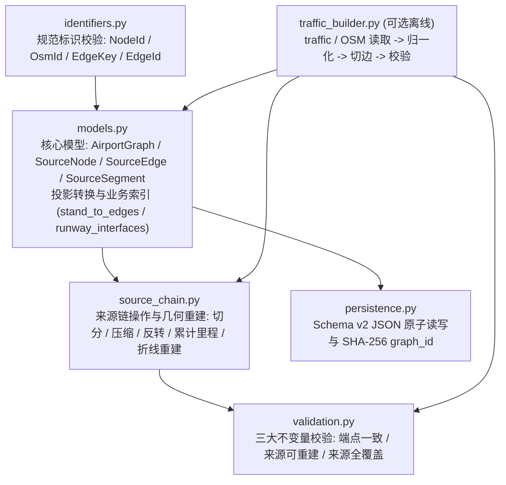
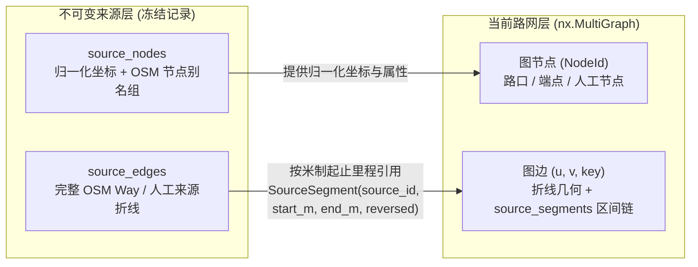
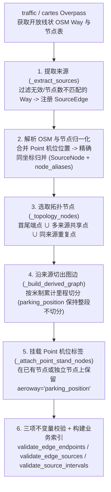

# `airport_surface`：机场地面路网数据设计与构建架构

`airport_surface` 定义了本项目的核心路网对象 `AirportGraph`，负责表达机场地面可通行连接、保留精确曲线几何、维护业务索引（机位与跑道接口），并支撑离线 OSM 建图、人工修复与 Schema v2 持久化。

- 日常建图、编辑与运行命令见 [快速上手与运行指南](quickstart.md#43-机场图构建与编辑)
- 模块文件索引与字典字段速查见 [机场图模块指南](../src/airport_surface/README.md)
- 路径匹配如何使用路网见 [匹配算法](path_map.md)

---

## 1. 模块架构与职责边界

重构后的 `airport_surface` 按职责拆分为 6 个小而清晰的模块，调用关系单向收敛：



| 模块 | 职责边界 |
|---|---|
| `identifiers.py` | 定义与校验稳定标识：`NodeId`（非零十进制字符串，正数来自 OSM、负数为人工节点）、`OsmId`、`EdgeKey`（非负整数）、`EdgeId`。 |
| `models.py` | 定义不可变来源对象（`SourceNode`、`SourceEdge`、`SourceSegment`）与可编辑图容器 `AirportGraph`，封装投影转换、边定向几何和业务索引。 |
| `source_chain.py` | 来源链纯算法与几何重建：切分、压缩、反转、折线累计里程，以及按米制里程区间重建 WGS84 折线。 |
| `validation.py` | 校验拓扑端点、几何可重建性与来源全覆盖三项不变量。 |
| `persistence.py` | Schema v2 持久化、确定性内容哈希 `graph_id` 与原子落盘。 |
| `traffic_builder.py` | 离线建图流水线（唯一依赖 `traffic` 可选依赖组的模块）。 |

---

## 2. 核心设计：拓扑与来源分离

OpenStreetMap 中的节点大多只是描绘弯道形状的采样点，并不都是路口。如果把所有 OSM 节点都做成图节点，路网会被大量无意义的二度点淹没；反之若只连端点直线，又会丢失真实滑行道曲率。

因此 `AirportGraph` 将**“当前可编辑拓扑”**与**“不可变几何来源”**明确分离：



- **当前路网（`graph`）**是 `nx.MultiGraph`（无向多重图）：
  - **无向**：仅描述地面物理连通性，不编码单向滑行规则或跑道运行方向（方向与转角约束由 `path_map` 在有向对偶图上处理）。
  - **多重边**：允许同一对端点间存在多条独立路径，因此每条边由三元组 `(u, v, key)` 唯一标识。
  - 边属性中的 `first`、`last` 仅标明该边 `geometry` 坐标与 `source_segments` 的排列起止端，不代表单向通行。
- **不可变来源层（`source_nodes`、`source_edges`）**：
  - 使用 `frozen=True, slots=True` 的 dataclass 配合递归冻结的 `MappingProxyType` 保存，禁止就地篡改。
  - 人工切分、合并或重连边时，只改变当前拓扑及其引用的 `source_segments`，不修改原始 `SourceEdge`；需要凭空补线时，则显式新增一条 `source_type="manual"` 的 `SourceEdge`。

---

## 3. 核心对象、坐标系与业务索引

### 3.1 坐标与投影
- 所有节点坐标（`pos`）、来源折线与图边几何均以 **WGS84 经纬度**（`EPSG:4326`）存储，便于地图展示与序列化。
- `AirportGraph.projection` 绑定一个显式指定的**水平单位为米的投影坐标系**（ZBAA 使用 `EPSG:32650`）。长度、来源里程、端点容差（`1e-3 m`）均在投影平面内计算，通过 `project_shape()` / `to_wgs84_shape()` 完成转换。

### 3.2 来源链与几何重建（`source_chain.py`）
每条图边通过有序元组 `source_segments: tuple[SourceSegment, ...]` 声明自己的几何来源：

```python
SourceSegment(
    source_id="osm-way-123456",
    source_start_m=0.0,     # 非负，沿来源曲线的米制累计里程
    source_end_m=84.5,      # 严格大于 source_start_m
    reversed=False,         # 反向遍历时设为 True，不交换起止数值
)
```

重建几何（`geometry_from_source_segments`）时：
1. 在米制投影平面内逐段截取来源曲线（`shapely.ops.substring`），按 `reversed` 决定方向；
2. 校验相邻片段首尾间距不超过 `1e-3 m` 并顺序拼接；
3. 将首尾坐标吸附到 `start_node` / `end_node` 的投影位置，再一次性转回 WGS84 折线。

编辑器对边做切分（`split_source_chain`）、反转（`reverse_source_segments`）或合并时，都会调用 `compact_source_segments` 自动合并同来源、同方向且首尾相接的相邻区间。

### 3.3 派生业务索引（`models.py`）
`AirportGraph` 从当前拓扑和边属性派生两套业务索引，供工作台检索和 `path_map` 构造 OD 边界使用：

- **机位索引（`stand_to_edges` / `edge_to_stand`）**：由 `rebuild_stand_index()` 构建。扫描所有 `aeroway == "parking_position"` 且 `ref` 非空（去空白后）的边，按 `str(ref)` 聚合为 `dict[str, tuple[EdgeId, ...]]`（允许同一机位对应多条边），并维护反向映射 `edge_to_stand` 与方向无关查询 `stand_for_edge()`。
- **跑道接口与边界边索引（`runway_interfaces` / `runway_to_edges` / `edge_to_runways`）**：由 `rebuild_runway_interfaces()` 构建。先找出同时关联至少一条 `aeroway == "runway"` 边和至少一条 `aeroway == "taxiway"` 边的节点（`runway_interfaces[node] = {"runway": ..., "taxiway": ...}`，供工作台 `[R]` 标注使用），再对称派生跑道侧边界边索引：`runway_to_edges` 按单向大写跑道号（如 `"18L"`、`"36R"`）映射到连接该跑道交叉口的 `taxiway` 边，`edge_to_runways` 维护反向映射（配合方向无关查询 `runways_for_edge()`），使机位侧与跑道侧在 `path_map` 中统一以边为边界。

> 直接修改底层 `graph` 后需手动调用上述两个 `rebuild_*` 方法；通过工作台 `EditorSession` 执行的编辑会自动同步刷新。

---

## 4. 离线自动建图流水线（`traffic_builder.py`）

离线建图入口为 `build_graph(icao, projection)` → `build_airport_graph(airport, proj)`，按 6 个阶段自顶向下执行：



关于 `osm.network_graph()` 的角色与边界：
- 构建器调用 `traffic` 底层 `cartes.osm.Overpass.network_graph()` 仅将其作为 **OSM 开放线状 Way 的拉取与解析载体**，不采用其拓扑划分。所有节点归一化、交叉点切分与业务分类均在 `traffic_builder.py` 内独立完成。
- **已知边界**：
  - 自动归一化只合并**坐标完全相同**的 OSM 节点，不做距离阈值吸附；无共享节点的几何相交不会自动打断连接，需在工作台人工修复。
  - `aeroway == "parking_position"` 的机位引导线默认保持首尾整段不切分，避免机位内部共享节点把单条机位边拆碎。
  - OSM 中首尾闭合的环状 Way 在 `cartes` 解析时会形成面几何，不进入开放 `LineString` 集合，如有缺失可在工作台人工补线。
  - 无效几何、节点坐标冲突、自环边、零长边等异常会记录在 `metadata.build_issues` 中供人工复核。

---

## 5. 三项结构一致性校验（`validation.py`）

构建完成与保存图文件前，通过以下三项校验保证拓扑、几何与来源之间不存在事实分歧（默认容差 `ENDPOINT_TOLERANCE_M = 1e-3 m`）：

| 校验函数 | 验证内容 | 适用阶段 |
|---|---|---|
| `validate_edge_endpoints` | 每条边的 `LineString` 非空，且几何首尾端点与拓扑节点 `(u, v)` 的投影位置误差 $\le 1\text{ mm}$。 | 自动建图、编辑器保存 |
| `validate_edge_sources` | 每条边均有非空 `source_segments`，引用的 `source_id` 与里程合法，且按来源链重建出的折线与保存的 `geometry` 的 Hausdorff 距离及长度差均 $\le 1\text{ mm}$。 | 自动建图、编辑器保存 |
| `validate_source_intervals` | 单遍扫描（$O(\lvert E\rvert + \lvert S\rvert)$）校验每条原始 `SourceEdge` 均被派生边区间从 `0` 到全长无缝、无重叠地完整覆盖。 | 自动建图（人工删边后的修订图不强制要求全覆盖） |

---

## 6. Schema v2 持久化与版本标识（`persistence.py`）

- **唯一支持的格式**：只读写显式声明 `schema_version = 2` 的 JSON 文档，不隐式兼容旧版 v1 或外部 NetworkX 图格式。
- **确定性内容标识 `graph_id`**：对除 `graph_id` 外的完整 JSON 载荷做 `sort_keys=True` 规范化序列化后计算 `sha256:...`。任何拓扑、几何或业务属性变化都会产生新的 `graph_id`，用于将批量匹配结果（`paths.jsonl`）精确绑定到对应的图快照。
- **原子写入与加载校验**：`save_graph()` 先写入 `.tmp` 临时文件再原子替换目标文件；`load_graph()` 读取时会校验 `schema_version` 与 `graph_id` 哈希完整性，并自动重建 `stand_to_edges` 与 `runway_interfaces`。

---

## 7. 与工作台编辑及路径匹配的边界

- **稳定标识与前后端契约**：Workbench API 直接传输 Schema v2 的规范标识（`NodeId` 保持字符串以避免 JavaScript `Number` 精度问题，边使用 `{u, v, key}`）。请求/响应模型由 FastAPI Pydantic 定义并生成前端 TypeScript 类型。
- **并发与版本控制**：`EditorSession` 在可重入锁内维护会话 `revision`。所有编辑、预览、撤销、保存与完成请求均携带 `expected_revision`，版本冲突返回 HTTP 409（`revision_conflict`），防止并发覆盖。
- **人工补线与航班模式边界**：工作台「直接绘制连接」会创建一条 `source_type="manual"` 的新来源及对应派生边，撤销时一并移除；航班匹配工作台则始终以只读方式加载已确认的机场图，航班机位归属保存在 PostgreSQL `public.flights` 表中。
