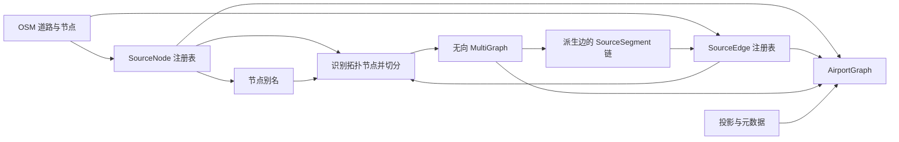
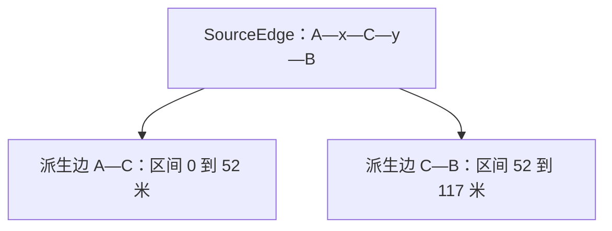
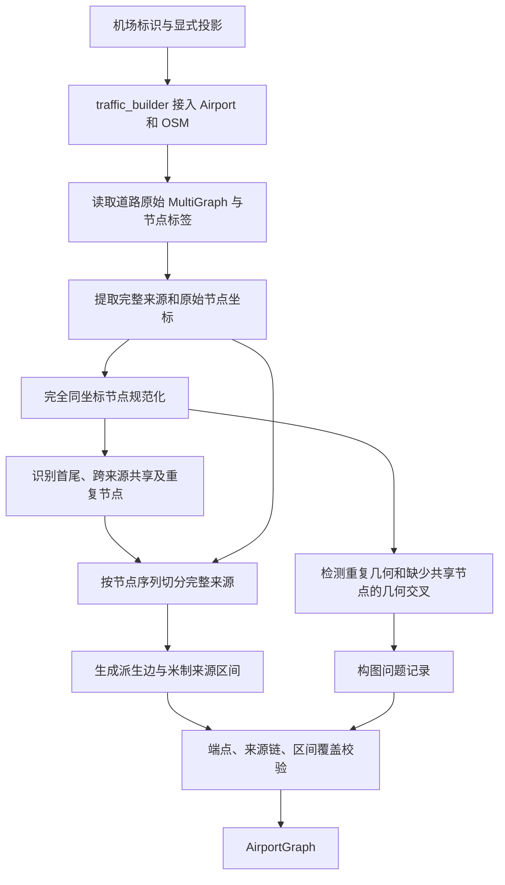

# AirportGraph 数据结构与构建原理

本文说明项目自有 `AirportGraph` 的数据结构、拓扑形成依据、来源几何重建机制，以及自动构图和持久化恢复的内部过程。它不是 `traffic` 提供的 AirportGraph 实现。

操作命令、调用示例和编辑流程见 [项目说明](../README.md) 与 [机场图建图与修复说明](graph_build_and_repair.md)。本文不展开 Workbench 界面、航班匹配和具体使用方式。

## 1. 设计目标：保留来源，派生拓扑

机场道路同时具有两种不同的表达需求：路径算法需要精简的节点和边，数据追溯需要完整的原始道路及其 OSM 节点序列。若只保存切分后的图边，后续删除、恢复和重新切分就会丢失依据；若把所有形状点都作为路由节点，又会让拓扑包含大量不影响连接关系的细节。

因此，AirportGraph 将数据分为两层：

- **来源层**：`SourceNode` 和 `SourceEdge` 保存构图时提取的节点身份、完整曲线与标签。
- **拓扑层**：无向 `networkx.MultiGraph` 保存用于路由的节点及派生边。每条派生边通过有序 `SourceSegment` 链引用来源区间。

来源层和拓扑层的数量不需要一致。一条来源道路可以派生多条图边；经过显式简化，一条图边也可以引用多条来源道路。删除派生边不意味着删除其来源。

## 2. 内部职责分工

| 文件 | 职责 |
|---|---|
| `src/airport_surface/models.py` | 数据记录、AirportGraph 容器、投影变换、来源链规范化与复制语义。 |
| `src/airport_surface/traffic_builder.py` | OSM 数据接入、显式投影解析、构图流程编排和构图后校验。 |
| `src/airport_surface/graph.py` | 来源提取、节点规范化、拓扑派生、来源几何重建、校验和持久化。 |

`traffic` 是构图工作流的可选依赖。已有图的模型、加载和校验不需要通过 traffic 重新取数。`airport_surface` 包的顶层不再导出旧的无参数构图快捷入口。

## 3. 来源层的数据结构

### 3.1 SourceNode：规范化的来源节点

| 字段 | 语义 |
|---|---|
| `node_id` | 规范节点 ID。构图时取完全同坐标分组中遇到的第一个 ID。 |
| `position` | WGS84 `(longitude, latitude)`。 |
| `osm_node_ids` | 该节点代表的全部原始 OSM node ID。 |
| `attributes` | 来源标签；自动构图将各原始 ID 的标签放在 `osm_node_attributes` 中。 |

完全相同坐标的多个 OSM 节点归入同一个 SourceNode。`node_aliases` 只保存非规范 ID 到规范 ID 的映射，规范 ID 自身不需要映射项。

`source_nodes` 包含提取到的来源节点，而拓扑层只选择其中影响连接关系的部分。因此，内部形状点可以存在于来源层，却不出现在 NetworkX 节点集合中。

### 3.2 SourceEdge：未切分的完整道路

| 字段 | 语义 |
|---|---|
| `source_id` | 注册表内唯一的来源标识。 |
| `geometry` | 完整、未切分的 WGS84 曲线；自动构图接受非空 LineString。 |
| `source_type` | 来源类型，自动构图为 `osm`。 |
| `osm_way_id` | 原始 OSM way ID，可以为空。 |
| `osm_node_ids` | 与曲线坐标顺序对应的原始节点序列，包含内部形状点。 |
| `attributes` | 道路业务标签，例如 `aeroway`、`ref`、`name`。 |

来源 ID 优先采用 `osm-way-{way_id}`；缺少 way ID 时使用原始图边标识。注册表内发生重名时追加数字后缀。因此它是一次构建中使用的来源键，不应被理解为独立于输入顺序的全球唯一道路 ID。

派生边切分、删除和重建不会反向裁剪 SourceEdge 的完整 geometry。

### 3.3 不可变性的边界

SourceNode 和 SourceEdge 使用 frozen dataclass；节点序列转换为 tuple，属性字典经过深拷贝并以 `MappingProxyType` 包装。记录字段不能重新赋值，属性映射顶层不能直接写入。

这不等于整个对象图递归不可变：属性值中嵌套的容器未被逐层冻结，AirportGraph 的来源注册表本身也是普通字典。来源稳定性仍是业务层必须遵守的约定，不能通过修改嵌套属性或替换注册项来绕过。

## 4. 拓扑层与来源链

### 4.1 无向 MultiGraph

拓扑层使用无向多重图：同一对节点之间可以有多条边，通过 `(u, v, key)` 区分。它表达机场道路的连接关系，不直接编码航班的实际行进方向。

自动构图节点保存 `pos`、`source_type` 和 `osm_node_ids`。`pos` 始终是 WGS84 经纬度。

派生边的核心字段如下：

| 字段 | 语义 |
|---|---|
| `geometry` | 当前图边的 WGS84 LineString。 |
| `first` / `last` | 派生 geometry 的首尾拓扑节点；自动构图时沿来源坐标顺序记录。 |
| `source_segments` | 有序来源链，是重建曲线的依据。 |
| `source_id` / `source_start_m` / `source_end_m` | 单区间边的兼容字段。 |
| `source_type` | 自动构图继承来源类型，多区间链经 `apply_source_segments()` 处理后标记为 `composite`。 |
| `osm_node_ids` | 自动切分片段包含的原始节点子序列。 |
| 业务属性 | 从来源继承的道路标签。 |

NetworkX 返回的无向端点顺序不保证等于 `first/last`。边的几何方向、来源区间遍历方向和无向连接关系必须分别处理。

### 4.2 SourceSegment：以米定义的来源区间

每个 SourceSegment 保存 `source_id`、`source_start_m`、`source_end_m` 和 `reversed`。构造时将区间端点转成浮点数，并拒绝负起点或终点不大于起点的区间。区间表示沿完整来源曲线累计的米制距离，不是经纬度差值。

`reversed=False` 表示从起始里程遍历到结束里程；`reversed=True` 表示反向遍历，区间数值仍按从小到大保存。

例如完整来源 A—x—C—y—B 在 C 处切分，x、y 只负责保留道路形状：

自动构图的每条边具有单元素来源链。多来源简化后的边则按实际曲线顺序保存多个区间，不能用单个 `source_id` 代替整条链。

`edge_source_segments()` 是统一的内部读取机制：它接受 SourceSegment 对象或字典记录，也将只有旧标量字段的边转换为单元素来源链。AirportGraph 初始化时会把识别到的来源链写回边属性。

## 5. AirportGraph 的聚合与坐标语义

AirportGraph 聚合以下状态：

| 状态 | 内容 |
|---|---|
| `graph` | 可变拓扑图。 |
| `source_nodes` / `source_edges` | 来源节点和完整道路注册表。 |
| `node_aliases` | 同坐标原始节点的规范化映射。 |
| `node_merge_groups` | 人工确认的节点合并记录，包括成员和原坐标。 |
| `node_snap_records` | 人工吸附记录，包括原坐标、新坐标、目标来源、里程和移动距离。 |
| `metadata` | `GraphMetadata`，保存机场标识和 `build_issues`。 |
| `projection` / `project` / `to_wgs84` | 投影定义以及两个方向的坐标变换器。 |

NodeMergeGroup 和 NodeSnapRecord 用于保留显式拓扑调整的依据；自动构图初始化为空，不会自动生成近距离合并或吸附记录。GraphMetadata 本身不保存文件格式版本，格式版本由持久化层管理。

原始曲线和图节点统一存为 WGS84；长度、来源里程、距离和容差在米制投影下计算。变换器设置 `always_xy=True`，统一以经度、纬度顺序输入。

投影由构图输入显式给定。`resolve_projection()` 检查它是投影坐标系，且前两个轴的单位换算系数为米；不根据机场名称自动推断投影。直接构造 AirportGraph 并不会执行同一套投影合法性检查。

AirportGraph 构造器保留传入的 NetworkX 图引用，为注册表创建新字典，为吸附记录创建新列表。`copy()` 则深拷贝拓扑图，并新建这些外层容器，但共享来源记录和元数据对象。它不是对所有成员统一执行递归深拷贝。

## 6. 自动构图的内部过程

### 6.1 数据接入与来源提取

`traffic_builder.build_graph()` 规范化机场标识、取得 traffic Airport，并解析显式投影。`build_airport_graph()` 调用机场的 OSM 数据接口，读取 `taxiway`、`runway` 和 `parking_position` 道路。traffic 在此负责数据接入，不承担本项目的自动吸附或拓扑修复。

`_extract_sources()` 遍历原始图边：

1. 检查 geometry 是非空 LineString，否则记录问题并跳过。
2. 取得 `nodes` 序列；若缺少，尝试使用原始边的首尾节点。
3. 检查节点数量等于坐标数量，否则记录问题并跳过。
4. 收集节点坐标，建立唯一来源 ID，剥离几何与旧派生字段，生成 SourceEdge。

同一个 OSM node ID 若出现不同坐标，当前实现保留首次记录的坐标并追加问题记录，但不会在此处直接丢弃整条来源。后续端点或来源校验仍可能拒绝构图结果。问题记录不能等同于“已修复”。

节点标签通过 `_node_attributes_from_osm()` 单独提取，只作为属性保留，不作为建立连接的证据。

### 6.2 完全同坐标节点规范化

`_canonicalize_source_nodes()` 按精确的 `(longitude, latitude)` 元组分组。每组第一个 ID 成为规范 ID，其余 ID 进入别名表，同时保存各原始节点的标签。

这一阶段没有距离阈值。坐标仅仅接近不会合并，完全相同的不同 ID 才会归入同一个来源节点。SourceEdge 仍保留原始节点序列，拓扑判定时再通过别名表转成规范 ID。

### 6.3 识别拓扑节点

`_topology_nodes()` 对规范化后的节点序列计算三个集合，并取并集：

- 每条来源的首尾节点；
- 被两个或更多不同来源共享的节点；
- 在同一来源序列中重复出现的节点。

重复节点可能表达回到同一点的曲线结构，不能简单当作普通形状点省略。普通内部节点虽然不进入拓扑集合，其坐标仍保留在派生 LineString 中。

### 6.4 几何交叉诊断

`_geometric_crossing_issues()` 用 STRtree 缩小候选来源对，再计算几何关系。完全相等的几何会产生重复来源提示；相交但没有共享规范节点的来源对会产生交叉提示。

该检查不新增交点、不吸附节点、不建立连接。其当前判定粒度是来源对：若两条来源在任意位置共享规范节点，就跳过该对的一般交叉提示，因此它不是逐个交点的完整拓扑审计。

### 6.5 按原始节点位置派生图边

`_build_derived_graph()` 先为拓扑节点添加 NetworkX 节点，并建立包含来源注册表和投影的 AirportGraph 容器。随后逐条处理 SourceEdge：

1. 将原始节点序列映射为规范 ID 序列。
2. 将完整来源投影，逐坐标段累加距离，得到每个原始坐标的米制里程。
3. 找出首尾及所有拓扑节点在序列中的位置。
4. 对相邻切分位置截取原始坐标子序列，生成派生 LineString。
5. 保存 `first/last`、局部原始节点序列、道路属性及对应米制区间，并写入单元素 SourceSegment 链。
6. 将派生边加入 MultiGraph。

切分依据是节点在来源序列中的位置，不是对任意附近点做投影猜测。截取时保留中间全部坐标，因此拓扑简化不会把弯曲道路替换为直线。

构造过程会记录生成的自环和可检测到的近零长度边；它不自动删除这些边。严格零长度区间也可能在 SourceSegment 构造阶段就被拒绝。最终能否返回图由构造约束和后续校验共同决定。

## 7. 来源链如何重建几何

单区间重建由 `geometry_from_source_interval()` 完成：先将完整来源投影，按累计里程截取曲线；若给定拓扑端点，则将片段首尾坐标替换为这些节点的投影坐标，最后转回 WGS84。

多区间重建由 `geometry_from_source_segments()` 完成：

1. 按来源链顺序分别截取区间。
2. 根据 `reversed` 调整每段坐标方向。
3. 在投影空间检查上一段终点与下一段起点的间距。
4. 间距在容差内时拼接，省略下一段的第一个坐标；超过容差则拒绝。
5. 如有指定的首尾拓扑节点，再对整体曲线的两个端点进行替换，转回 WGS84。

因此，显式节点调整后可以重建派生边的端点，而不改变完整来源 geometry。端点替换不会自动弥合来源链内部的不连续。

来源链反向需要同时颠倒区间顺序并翻转每段的 `reversed`。相邻、同来源、同方向且里程衔接的区间可以压缩；仅几何接近或来源相同并不足以合并。

`rebuild_source_edges()` 是以指定来源和有序边界重新派生图边的内部机制：移除引用该来源的当前派生边，再生成相邻边界间的单来源边。它不改写完整来源，也不是自动保留任意复合链语义的通用重建器。`source_boundaries()` 当前从单来源兼容字段读取边界。

## 8. 构图不变量与校验边界

自动构图依次执行三项校验，默认米制容差为 `0.001 m`：

| 校验 | 检查内容 | 保证的性质 |
|---|---|---|
| `validate_edge_endpoints()` | 派生 geometry 为非空 LineString，首尾与无向节点端点在任一方向下一一对应。 | 几何端点与拓扑连接一致。 |
| `validate_edge_sources()` | 来源链非空、来源存在、区间终点未越界、链可连续重建；重建与保存曲线的 Hausdorff 距离和长度差均在容差内。 | 派生曲线可由声明的来源链解释。 |
| `validate_source_intervals()` | 每个来源有派生区间，首尾覆盖完整来源，相邻区间无超容差缺口或重叠。 | 初始构图完整覆盖来源。 |

三者不能互相替代：端点正确不代表中间曲线正确，曲线可追溯不代表来源没有遗漏，覆盖完整也不证明不同道路之间应当连通。

区间覆盖是自动构图的要求，不是所有后续拓扑状态的要求。人工明确删除派生边后，来源仍应保留，此时完整覆盖校验可能按设计失败。

`build_issues` 保存诊断信息，不是整个机场道路已通过业务正确性审核的证明。构图也不要求所有节点属于同一个连通分量；没有来源证据的连接不会为追求连通而自动补上。

## 9. 持久化表示与内部恢复

持久化层保存来源和拓扑的完整表示，而非只保存 NetworkX 的连接关系：

- `schema_version`、`graph_id`；
- `airport`、`projection`、`build_issues`；
- `source_nodes`、`source_edges`、`node_aliases`；
- `node_merge_groups`、`node_snap_records`；
- `nodes`、`edges`，其中边包含 geometry 和来源链。

### 9.1 内容标识与格式版本

当前 `schema_version` 为 1，表示文件结构约定。加载器拒绝不支持的版本；旧文件缺少版本字段时，按当前版本解释。

`graph_id` 是持久化文档除自身字段之外的内容摘要。实现将字典键排序、使用紧凑 JSON 编码并计算 SHA-256；投影、来源、属性和拓扑都参与摘要。因此它不是单纯的拓扑 ID，也不是图同构意义上的规范标识：数组顺序仍影响摘要。

保存时先生成完整文档和摘要，再写临时文件并替换目标文件。加载时若存在 `graph_id`，先校验其与文档内容一致；旧文件没有该字段时跳过摘要校验。

### 9.2 对象恢复顺序

加载器在版本和摘要检查后，恢复 NetworkX 节点、图边及 Shapely 几何，将来源链字典还原为 SourceSegment；随后恢复来源注册表、元数据、人工调整记录和投影，最后构造 AirportGraph。

来源注册表中的记录重新经过各自构造器的规范化；AirportGraph 初始化还会把旧单来源标量字段规范化为来源链。缺少的可选历史注册表按空容器恢复。旧投影文本 `UTM zone 50` 仍有兼容分支，其他投影按保存的定义解析。

恢复过程不重新接入 OSM、不重新识别拓扑、不自动简化或吸附，也不会重新执行三项完整构图校验。版本及摘要检查确认格式兼容和内容一致性，不能替代几何、来源和拓扑不变量校验。
