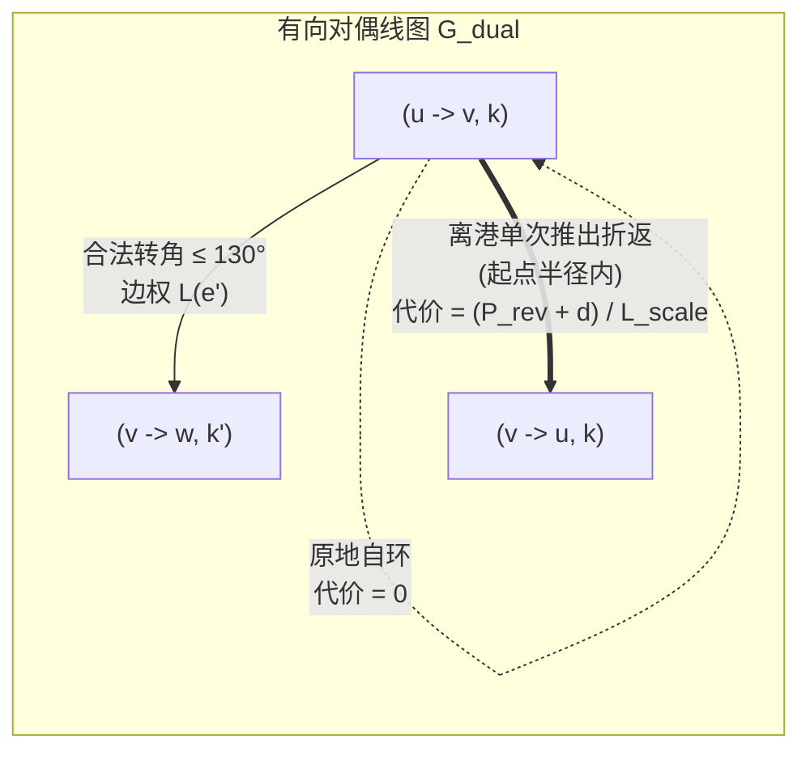

# 边级状态对偶图 DTW（Edge-Anchored Dual-Graph DTW）算法文档

本文档详细说明 [edge_dtw.py](file:///d:/code/adsb-processing/src/path_map/edge_dtw.py) 中实现的**边级状态对偶图 DTW** 地图匹配算法，包括其提出动机、数学建模、与通用 [viterbi.py](file:///d:/code/adsb-processing/src/path_map/viterbi.py) 及有向对偶图 [router.py](file:///d:/code/adsb-processing/src/path_map/router.py) 的协作方式、超参数物理意义，以及与原投影点 HMM（[hmm.py](file:///d:/code/adsb-processing/src/path_map/hmm.py)）在真实 ZBAA 航班上的对比结论。

---

## 1. 背景：为什么原投影点 HMM 容易受抖动干扰且补丁繁多？

经典地图匹配 HMM（Newson & Krumm 2009）将每个观测点 $z_t$ 垂直投影到候选边上，以投影点 `(edge, offset)` 作为隐藏状态，并用“沿网距离 $D$ 与观测直线距离 $r$ 之差”打分：

$$
E(d_\perp) = -\frac{d_\perp^2}{2\sigma^2} - \log(\sigma\sqrt{2\pi}), \qquad
T(D, r) = -\frac{|D - r|}{\beta}
$$

当该模型与**机场地面强转角约束（有向对偶线图禁止 $>130^\circ$ 掉头）**结合后，在低速/静止段（尤其是机位停靠、推出点、路口排队）会暴露出两个根源性的建模矛盾：

### 1.1 纵向噪声被硬编码进状态坐标

将 2D 各向同性高斯定位误差 $\epsilon_t \sim \mathcal{N}(0, \sigma^2 I_2)$ 沿滑行道切向 $\hat{t}$ 与法向 $\hat{n}$ 分解：

- **横向误差 $\epsilon_\perp$**：由发射得分 $E(d_\perp)$ 软吸收；
- **纵向误差 $\epsilon_\parallel$**：由于状态位置取为投影里程 `offset = line.project(z_t)`，模型隐式假设了“纵向误差为 0”，把纯噪声导致的 `offset` 倒退当成了**飞机真的往回移动**。

在无向自由图上，这种误判顶多损失一点转移分；但在**禁止掉头的有向对偶线图**上，倒退是非法的（转移概率为 $0$，即 $-\infty$）。于是不得不打上层层启发式补丁：
- `same_edge_jitter_m = 5.0`：允许普通边上 $\le 5\text{ m}$ 的同边回退；
- `router._stand_edges` 豁免：对 `parking_position` 机位边彻底取消同边回退上限；
- 但只要噪点稍微越过机位与滑行道的连接节点再抖回来，同边豁免立刻失效，仍会导致断链（`NO_LEGAL_PATH`）或提前浪费离港唯一的推出折返机会。

### 1.2 观测步长 $r_t$ 的瑞利正偏置（Phantom Drift）

当飞机原地静止（真实沿网位移 $D = 0$）而 ADS-B 以标准差 $\sigma$ 随机抖动时，相邻两帧的欧氏距离 $r_t = \|z_t - z_{t-1}\|$ 服从瑞利分布，其期望**恒为正**：

$$
\mathbb{E}[r_t] = \sqrt{\pi}\,\sigma \approx 1.77\,\sigma
$$

当 $\sigma = 10\text{ m}$ 时，连续 20 帧原地抖动会产生约 $350\text{ m}$ 的虚假累积位移：
- 若状态老实停在原地（$D = 0$），每帧都要支付 $-r_t / \beta$ 的转移惩罚；
- 若状态顺着周边滑行道向前走或绕一个小环（让 $D \approx r_t$），转移惩罚反而趋近于 $0$。

这种单向正偏置会把本该静止的飞机“推”出机位或“推”进闭合环路，又倒逼代码加入了 `max_transition_detour_m = 250.0` 与 `has_boundary_layers` 首尾特判等更多补丁。

---

## 2. 核心思想：边级状态 + 驻留自环 + 长度正则

正如**有向对偶线图**把“转角合法性”从过程式 `if` 判断提升为图结构本身，**边级状态对偶图 DTW** 从概率图模型本身消除了上述两个矛盾：

1. **状态不再绑定观测投影点，而是直接锚定到有向对偶图的顶点（有向边 $e$）**，彻底消除 `offset` 与 `fraction`；
2. **发射项使用点到线段的完整 2D 距离** $\operatorname{dist}(z_t, e)$，同时吸收横向误差与超出端点的纵向误差；
3. **转移项彻底抛弃 $|D - r|$**，改为**“同边驻留免费 + 跨边按对偶图沿网长度正则化”**。

从图论视角看，这等价于在“时间步 $t \times$ 有向对偶图 $G_{\text{dual}}$”的乘积图上求解带长度正则的 **Graph-DTW 最优对齐路径**；在工程实现上，它依然是标准分层序列 DP，可以直接复用 [viterbi.py](file:///d:/code/adsb-processing/src/path_map/viterbi.py) 中的通用 `viterbi()`。

---

## 3. 完整数学模型

### 3.1 有向对偶线图 $G_{\text{dual}}$

直接复用 [router.py](file:///d:/code/adsb-processing/src/path_map/router.py) 构建的 `DirectedNetworkRouter.graph`：

- **顶点集 $V_{\text{dual}}$**：原无向路网中所有非自环、非零长边 `(u, v, key)` 拆成的双向有向边 `(u, v, key)` 与 `(v, u, key)`。
- **有向边集 $E_{\text{dual}}$**：对任意满足终点接起点的有向边对 $e_1 = (a \to b)$、$e_2 = (b \to c)$，若末端切线与起端切线夹角 $\theta(e_1, e_2) \le \theta_{\max}$（默认 $130^\circ$），则连边 $e_1 \to e_2$，边权为进入边的长度：
  $$
  w(e_1 \to e_2) = L(e_2)
  $$
- **对偶最短路距离 $d_{\text{dual}}(e_1, e_2)$**：在 $G_{\text{dual}}$ 上从顶点 $e_1$ 到顶点 $e_2$ 的最短路径权重和（即从离开 $e_1$ 起至完整进入 $e_2$ 止，途径所有后续边的长度之和）。由 `router.distances_from(e_1)` 按需缓存计算。

### 3.2 积状态空间（Product State）

为支持离港航班在推出阶段（Pushback）执行最多一次原地 $180^\circ$ 换向，定义状态：

$$
s = (e,\; r) \in V_{\text{dual}} \times \{0, 1\}
$$

对应代码中的 `EdgeState(edge: EdgeId, reversed_used: bool)`：
- $r = 0$（`reversed_used=False`）：尚未执行推出折返；
- $r = 1$（`reversed_used=True`）：已执行过唯一一次推出折返，后续全程受 $G_{\text{dual}}$ 严格转角约束。
- 进港航班（`allow_single_reversal=False`）仅构造 $r = 0$ 状态；离港航班第 $0$ 层仅含 $r = 0$，第 $1 \dots T-1$ 层同时包含 $r = 0$ 与 $r = 1$。

### 3.3 发射得分（Emission Score）

对于第 $t$ 帧观测点 $z_t$ 与状态 $s = (e, r)$，发射得分仅取决于 $z_t$ 到边 $e$ 几何线段的 2D 欧氏距离 $d(z_t, e)$：

$$
E_t(e) = -\frac{d(z_t, e)^2}{2\sigma^2} - \log(\sigma\sqrt{2\pi})
$$

注意：
- 正向边 `(u, v, key)` 与反向边 `(v, u, key)` 共享同一几何线段，因此具有相同的发射得分；方向由转移约束与前后观测共同决定。
- 当 $z_t$ 落在边 $e$ 的两端之外时，$d(z_t, e)$ 自动等于点到最近端点的距离，**天然惩罚纵向偏离**。

### 3.4 转移得分（Transition Score）

设第 $t-1$ 层状态为 $s_1 = (e_1, r_1)$，第 $t$ 层状态为 $s_2 = (e_2, r_2)$，长度正则尺度为 $L_{\text{scale}}$（`length_scale_m`，默认 $50.0\text{ m}$），折返等效惩罚长度为 $P_{\text{rev}}$（`reversal_penalty_m`，默认 $40.0\text{ m}$）：

1. **同阶段正常转移（$r_1 = r_2$）**：
   $$
   T_{\text{normal}}(e_1 \to e_2) =
   \begin{cases}
   0, & e_1 = e_2 \quad \text{（原地驻留 / 同边滑行）} \\[6pt]
   -\dfrac{d_{\text{dual}}(e_1, e_2)}{L_{\text{scale}}}, & e_1 \neq e_2 \text{ 且 } e_2 \text{ 可达} \\[6pt]
   -\infty, & \text{不可达}
   \end{cases}
   $$

2. **离港单次原地推出折返（$r_1 = 0 \to r_2 = 1$）**：
   仅当 `allow_single_reversal=True` 且上一帧观测点满足 $\|z_{t-1} - p_{\text{origin}}\| \le R_{\text{pushback}}$（默认 $250\text{ m}$）时开放。设 $e_1 = (u, v, k)$ 的反向边为 $\operatorname{rev}(e_1) = (v, u, k)$：
   $$
   T_{\text{rev}}(e_1 \to e_2) =
   \begin{cases}
   -\dfrac{P_{\text{rev}}}{L_{\text{scale}}}, & \operatorname{rev}(e_1) = e_2 \\[6pt]
   -\dfrac{P_{\text{rev}} + d_{\text{dual}}(\operatorname{rev}(e_1), e_2)}{L_{\text{scale}}}, & \operatorname{rev}(e_1) \neq e_2 \text{ 且 } e_2 \text{ 可达} \\[6pt]
   -\infty, & \text{不可达}
   \end{cases}
   $$

3. **禁止回退阶段（$r_1 = 1 \to r_2 = 0$）**：得分恒为 $-\infty$。

### 3.5 全局优化目标

综合发射得分与转移得分，Viterbi 求解的最优状态序列 $S^* = (s_0, \dots, s_{T-1})$ 等价于最小化：

$$
\min_{S} \;\; \underbrace{\sum_{t=0}^{T-1} \frac{d(z_t, e_t)^2}{2\sigma^2}}_{\text{2D 几何拟合误差}} \;+\; \underbrace{\frac{1}{L_{\text{scale}}} \Bigl( \sum_{\text{跨边步}} d_{\text{dual}}(\cdot) \;+\; \mathbb{I}_{\text{rev}} \cdot P_{\text{rev}} \Bigr)}_{\text{总行进路径长度正则 + 折返惩罚}}
$$

### 3.6 为什么该目标函数天然具备“迟滞防抖”与“抑环”特性？

用默认参数 $\sigma = 10\text{ m}$、$L_{\text{scale}} = 50\text{ m}$ 算三笔直观账：

1. **机位/滑行道原地抖动**：
   - 连续 50 帧在机位边来回抖动 15 m：留在原边 $e$ 的转移代价恒为 **$0$**；绝无“虚假推进力”把状态推出机位。
2. **路口单点越界抖动（迟滞效应 / Hysteresis）**：
   - 假设飞机停在边 $e_1$ 末端，某一帧噪点越过路口探入长 $50\text{ m}$ 的下条边 $e_2$ 达 $5\text{ m}$，下一帧又回到 $e_1$：
     - 留在 $e_1$：多付发射代价 $5^2 / (2 \times 10^2) = \mathbf{0.125}$；
     - 跳进 $e_2$：必须立刻支付进入边长代价 $50 / 50 = \mathbf{1.0}$（且跳过去后回不来！）。
   - 因此单个噪点**不可能**触发误切边；只有当飞机真正沿 $e_2$ 持续滑行（连续多帧远离 $e_1$，发射代价迅速飙升至几十上百）时，模型才果断切入 $e_2$。
3. **抑环 vs 不切真实弯道**：
   - **虚假 $500\text{ m}$ 闭合环路**：长度正则直接重罚 $500 / 50 = \mathbf{10.0}$，无观测支撑的假环会被直接压死；
   - **真实平行滑行道绕行**：假设某班飞机按 ATC 指令走旁边相距 $30\text{ m}$、总长多 $300\text{ m}$ 的平行滑行道。多出来的长度惩罚为 $300 / 50 = 6.0$，而哪怕只有 **2 个** 观测点落在这条平行滑行道上，留在短滑行道就要多付 $2 \times 30^2 / 200 = \mathbf{9.0} > 6.0$。因此只要有真实轨迹支撑，模型绝不会为了省长度而“切弯”。

### 3.7 OD 边界约束的统一表达（Phase 1 与 Phase 2）

- **Phase 1（纯轨迹解码）**：`start_edges=None, end_edges=None`，直接对观测层解码。
- **Phase 2（OD 边界兜底）**：在首部插入一层 `start_edges`、在尾部追加一层 `end_edges`，且边界层的发射得分设为 $0.0$。
  - 若第一帧观测恰好已在起始机位边上，$e_{\text{start}} = e_0$，接入代价为 $0$；
  - 若首尾存在信号遮挡缺失，边界层与首/末观测层之间的转移得分 $-\frac{d_{\text{dual}}}{L_{\text{scale}}}$ 会**自动选择最短的合法转角接入路径**。
  - 无需像原 HMM 那样伪造 `Candidate(-1, ...)`、复制 `boundary_observations` 或设置 `has_boundary_layers` 豁免 `max_transition_detour_m`。

---

## 4. 算法实现与路径重建

完整实现位于 [edge_dtw.py](file:///d:/code/adsb-processing/src/path_map/edge_dtw.py)，共 5 个清晰步骤：

1. **无向候选转双向边距离表**（`directed_edge_distances`）：
   - 将 `CandidateIndex` 召回的 Top-K 无向候选边展开为 `(u, v, key)` 和 `(v, u, key)`，记录每个有向边到当前观测点的最小 2D 距离 `distance`（丢弃 `offset`/`fraction`）。
2. **构造分层状态与发射得分**（`decode_edge_route`）：
   - 按需拼接 `start_edges` / `end_edges` 边界层；
   - 为每层生成 `(EdgeState, emission)` 列表，使通用 `viterbi()` 无需感知分层发射表。
3. **构造每步转移策略**（`EdgeTransitionStep`）：
   - 仅保留 4 个字段：`router`、`length_scale_m`、`allow_reversal`、`reversal_penalty_m`；
   - `_prepare()` 将上一层可达状态按阶段分为 `normal_p0`、`normal_p1`、`reversed_p0` 三组，并提前取出 `router.distances_from(edge)` 字典；
   - `best_predecessors()` 对当前层每个目标状态找到最优前驱得分与下标。
4. **调用纯通用 Viterbi 解码**：
   - 直接调用 [viterbi.py](file:///d:/code/adsb-processing/src/path_map/viterbi.py) 的 `viterbi(scored_layers, lambda item: item[1], step_scorers)`，返回最优 `EdgeState` 序列。
5. **连续有向路径重建**（`reconstruct_edge_path`）：
   - 初始化 `output = [DirectedEdge(*states[0].edge)]`；
   - 对相邻状态 `(prev, curr)`：
     - 由 `is_reversed = (not prev.reversed_used) and curr.reversed_used` 判断该步是否发生原地推出折返；
     - 若发生折返，令 `start_edge = rev(prev.edge) = (v, u, key)` 并追加 `DirectedEdge(*start_edge)`（因 `prev.edge.to_ == v == start_edge.from_`，拓扑天然连续）；否则 `start_edge = prev.edge`；
     - 若 `start_edge == curr.edge`（驻留），跳过；
     - 否则查 `router._route(start_edge, curr.edge)` 取出不含首边的 `tail_edges` 直接 `output.extend(tail_edges)`（因对偶图边保证首尾相接，无需再做边界边去重）。

### 复杂度对比
- 设观测层数为 $T$，每层 Top-K 无向候选为 $K$（默认 $16$），双向展开后状态数为 $M = 2K$（离港含两阶段为 $4K$）。
- 单步转移复杂度为 $O(M^2)$ 次字典查询（全在 `distances_from` 缓存内完成）。
- 相比原投影点 HMM：
  - 消除了路口节点展开为全部入边带来的状态数膨胀；
  - 消除了内层 `offset`、`remaining`、`target_adj`、`same_edge_jitter_m`、`_stand_edges` 等浮点与集合判断；
  - 消除了 `AnchoredSource` 与 `Transition` 构造开销。

---

## 5. 超参数物理意义与调参说明

新模型将原有 7+ 个算法参数收敛为 **4 个核心物理参数**（外加折返惩罚常量）：

| 参数 | 默认值 | 物理含义 | 调参影响 |
|---|---|---|---|
| `gps_sigma` ($\sigma$) | `10.0 m` | ADS-B 2D 定位误差标准差 | 越大越宽容横向偏离，越倾向走短路径 |
| `length_scale_m` ($L_{\text{scale}}$) | `50.0 m` | 路径长度正则尺度（每多走 $L_{\text{scale}}$ 米扣 $1.0$ 分） | **太小**（如 `10 m`）：迟滞过强，末端仅探入几米的边界边可能不切入；**太大**（如 `200 m`）：抑环与防路口抖动能力减弱 |
| `max_transition_turn_angle_deg` ($\theta_{\max}$) | `130.0°` | 对偶图允许的最大局部切线转角 | 过滤非法急转与原地掉头 |
| `max_pushback_radius_m` ($R_{\text{pushback}}$) | `250.0 m` | 离港允许执行单次推出折返的最大离机位半径 | 防止滑行中段误触发折返 |
| `reversal_penalty_m` ($P_{\text{rev}}$) | `40.0 m` | 单次推出折返的等效路径长度惩罚 | 防止顺向直接滑出机位时误触发折返 |

---

## 6. 对比总结与 ZBAA 真实航班实测

### 6.1 模型与工程复杂度对比

| 维度 | 原投影点 HMM（[hmm.py](file:///d:/code/adsb-processing/src/path_map/hmm.py)） | 边级状态 Edge-DTW（[edge_dtw.py](file:///d:/code/adsb-processing/src/path_map/edge_dtw.py)） |
|---|---|---|
| 隐藏状态 | `(Candidate(edge, offset, fraction), phase)` | `(EdgeId, reversed_used)` |
| 纵向抖动处理 | 依赖 `same_edge_jitter_m` + `_stand_edges` 特判 | 同边自环 $T(e \to e) = 0$，零特判 |
| 静止瑞利偏置 | 存在，需用 `max_transition_detour_m` 压制 | 彻底消除 |
| 路口候选展开 | 需按 `offset <= 1e-9` 展开为节点全部入边 | 无需，仅双向展开 `(u,v,k)` / `(v,u,k)` |
| 虚拟 OD 边界 | 需伪造 `Candidate(-1)`、`boundary_observations`、`has_boundary_layers` | 直接首尾附加零发射 `edge` 集合 |
| 路径重建 | 需 `Transition` + `recover_edges` + 共享边界边去重 | 直接拼接对偶最短路 `tail_edges` |

### 6.2 300 班真实 ZBAA 航班实测（150 离港 + 150 进港）

测试条件：相同 `zbaa_final.json` 路网、`gps_sigma=10.0`、`max_transition_turn_angle_deg=130.0`、`max_pushback_radius_m=250.0`；Edge-DTW 使用 `length_scale_m=50.0`。

| 指标 | 原投影点 HMM | 边级状态 Edge-DTW（`50 m`） | 变化 |
|---|---:|---:|---|
| 总耗时 | `10.48 s` | **`3.23 s`** | **提速 3.2×** |
| 匹配成功 | `238 / 300` | **`250 / 300`** | **+12 班** |
| `no_legal_path` 失败 | `15` | **`0`** | **清零** |
| `closed_loop` 异常环路 | `12` | **`7`** | **-42%** |
| `missing_od` 失败 | `47` | `50` | +3 班 |

- 两者均成功的 `234` 班中，有 **`199` 班（85.0%）** 产出的有向边序列完全一致；
- 仅 Edge-DTW 成功 `16` 班（主要来自原 HMM 在机位口/路口因抖动触发 `no_legal_path` 的案例）；
- 仅原 HMM 成功 `4` 班（其中 3 班为无 OD 标签航班在 Phase 1 末端仅探入边界边数米，因 $L_{\text{scale}} = 50\text{ m}$ 的迟滞门槛未切入边界边而回退为 `missing_od`）。

---

## 7. 已知局限与后续可探索方向

1. **超长边末端轻触时的迟滞权衡**：
   - 在 Phase 1（无 OD 边界）下，如果最后一条机位边或跑道接口边很长（如 $>100\text{ m}$），而轨迹仅在末端探入了几米，过小的 `length_scale_m` 会让模型停留在前一条边。
   - 可通过实测调大 `length_scale_m`（如 `80~100 m`），或对首末边界进入边使用折半长度权重来进一步缓解。
2. **残留的少量 `closed_loop`（300 班中 7 班）**：
   - 主要是真实地面等待绕行、或存在长距离单帧极端飞点（outlier）导致。由于发射项采用二次方 $d^2 / (2\sigma^2)$，单个 100 m 飞点会产生 $-50$ 的巨大拉力；若后续需要对抗极端飞点，只需将二次发射改为 **Huber / 截断二次发射**（例如 $\min(d, d_{\max})^2 / (2\sigma^2)$）即可一行解决。
3. **与轨迹前置去抖的正交性**：
   - 切换为 Edge-DTW 后，前置去抖不再是“防止算法崩坏的刚需”，而是纯粹的**加速选项**（压缩机位静止帧数以进一步减少 $T$）。
