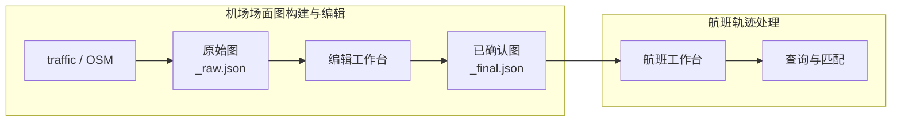

# 机场图建图与修复

机场路网先离线构建，再经人工检查和修复，最后作为已确认的 JSON 提供给航班匹配。

图对象、来源区间和版本标识见[机场图数据设计](airport_surface.md)。

## 1. 准备环境

从仓库根目录安装离线建图依赖：

```powershell
uv sync --group graph-build
```

已有图可直接使用普通 Python 环境加载。浏览器编辑使用共享的 Workbench 前端，首次使用或更新前端后请[构建静态资源](../frontend/workbench/README.md)。

## 2. 生成原始机场图

```powershell
uv run --group graph-build python scripts/build_airport_graph.py `
  --airport ZBAA `
  --projection EPSG:32650 `
  --output data/graphs/zbaa_raw.json
```

| 参数 | 用途 |
|---|---|
| `--airport` | ICAO 机场代码。 |
| `--projection` | 适合该机场的米制投影。 |
| `--output` | 图文件路径，省略时生成 `data/graphs/<icao小写>_raw.json`。 |
| `--force` | 允许替换已有输出。 |

建图脚本校验图的端点和来源区间，保存 JSON，再用生产加载入口回读并核对图标识。检查输出的构图疑点后进入编辑工作台。

## 3. 选择编辑入口

需要保留原图并写出独立修订版时，使用修复脚本：

```powershell
uv run python scripts/repair_airport_graph.py `
  --input data/graphs/zbaa_raw.json `
  --output data/graphs/zbaa_final.json
```

输出文件已存在时，选择新文件名，或确认要覆盖后加 `--force`。要查看或直接编辑已有图，可使用：

```powershell
uv run python -m airport_workbench --graph data/graphs/zbaa_final.json
```

独立图编辑入口的「保存」写回传入的图文件；修复脚本的「保存」和「完成」写入 `--output`，「完成」随后停止该服务。

默认地址是 [http://127.0.0.1:8765/](http://127.0.0.1:8765/)。这两个图编辑入口都支持 `--host`、`--port`、`--no-browser`。例如加 `--port 8877 --no-browser`，再手动访问 [http://127.0.0.1:8877/](http://127.0.0.1:8877/)。

## 4. 检查、修改和保存

页面初始处于查看状态。可搜索节点、边端点或机位编号 `ref`，也可打开拓扑检查。机位搜索命中多条边时，从候选结果中选择。

点击「编辑图」进入编辑。左侧工具支持切分、绘制缺失连接、恢复来源连接、合并重合节点、人工吸附和删除。属性浮层可修改 `aeroway`、`name` 和 `ref`；`aeroway` 支持 `taxiway`、`runway` 和 `parking_position`。

「保存属性」将修改应用到当前会话，可使用「撤销」。编辑完成后点击顶部「保存」或修复模式的「完成」，才会验证并写入图文件。关闭标签页会保留服务，终端按 `Ctrl+C` 停止服务；未保存的会话改动需要在停止前写入图文件。

## 5. 将确认后的图交给航班匹配

将确认后的图路径填入 `config.local.toml` 的 `graph_path`。航班模式使用这份图进行查询和路径匹配，航班机位则存放在 DuckDB 中。两种 Workbench 共用浏览器资源，图编辑会话只展示地图编辑功能，航班会话的图为只读。

航班模式的启动、筛选、机位编辑和报告说明统一放在[航班路径匹配运行说明](path_matching_run.md)。
