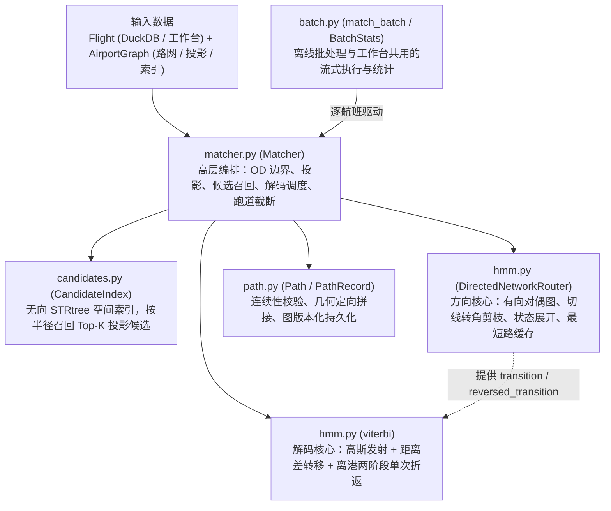
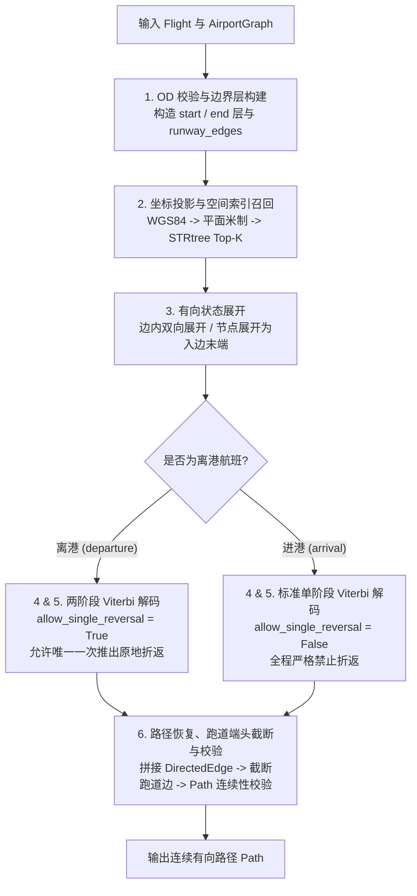
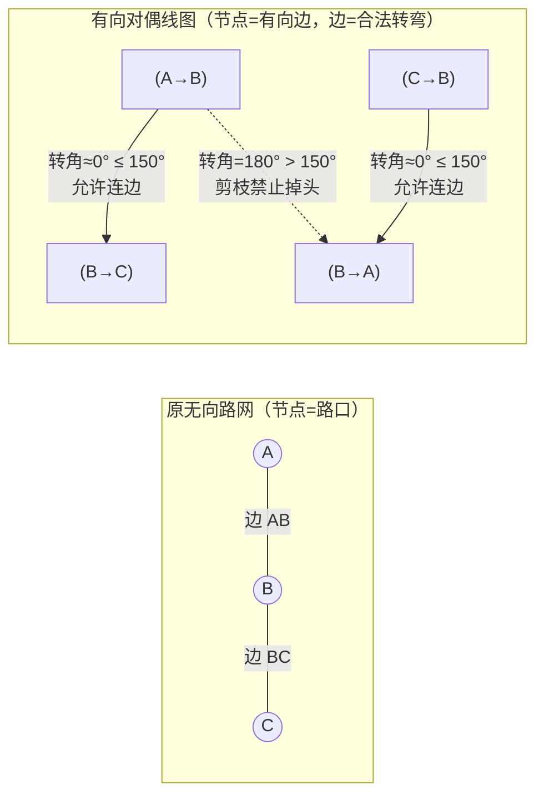

# `path_map`：机场地面路径匹配算法与模块架构

`path_map` 使用已校验的 `Flight` 观测轨迹和 `AirportGraph` 机场路网，估计航班在机位与跑道之间经过的有向边序列。本文说明当前版本的**模块架构**、**核心约束设计**与**单航班匹配算法原理**。

- 机场图数据结构、机位/跑道业务索引与版本标识见 [机场图数据设计](airport_surface.md)
- 命令行启动、配置项与结果文件见 [快速上手与运行指南](quickstart.md)
- 编程调用示例见 [匹配模块开发指南](../src/path_map/README.md)

---

## 1. 模块架构与职责边界

重构后的 `path_map` 将所有“边方向、局部切线、有向对偶图与解码”细节收敛进 `hmm.py`，其余模块保持薄而单一的职责：



| 模块 | 核心职责 |
|---|---|
| `matcher.py` | 定义 `MatchConfig`、`MapMatchingFailure` 与 `Matcher`，串联单航班完整流水线。 |
| `candidates.py` | 定义 `Candidate` 与 `CandidateIndex`，基于 `AirportGraph.oriented_edge_geometry` 对无向边建米制 `STRtree` 索引。 |
| `hmm.py` | 算法核心：`DirectedNetworkRouter`（有向对偶线图、局部切线转角过滤、有向展开、边界构造、原地折返、带缓存最短路）与 `viterbi` 解码器。 |
| `path.py` | 定义 `DirectedEdge`、`Path`（边存在性与首尾连续性校验、按遍历顺序拼接几何）及绑定 `graph_id` 的 `PathRecord`。 |
| `batch.py` | 流式批处理 `match_batch()`、`MatchOutcome` 与统一统计累加器 `BatchStats`。 |

---

## 2. 为什么需要基于路网的 HMM 匹配

直接把每个 ADS-B 观测点吸附到最近路段（贪心法）存在三个问题：

1. **局部最优不等于全局最优**：平行滑行道间距较近，受定位噪声影响，单个点离旁边滑行道更近并不代表飞机走上了那条道。
2. **路径不连通或违背物理运动**：逐点就近吸附容易选出断开的路段，或在交叉口产生原地 180° 掉头、逆向急转进出快速脱离道等非法走法。
3. **缺少起终点与阶段约束**：需要结合机位、跑道以及离港推出折返等机场地面运行特征做全局求解。

---

## 3. 核心约束：OD 约束与转角约束

在进入具体流水线前，先明确本项目为机场地面滑行引入的两类核心先验约束：**它们是什么**以及**如何在算法中实现**。

### 3.1 OD 约束（起终点约束）

- **是什么**：
  每条地面滑行轨迹都有明确的运行方向（离港 `departure` / 进港 `arrival`）与起终点语义——离港必须从**机位**出发到达**跑道**，进港必须从**跑道**脱离到达**机位**。即使轨迹首尾存在 ADS-B 信号缺失（如机坪遮挡、脱离跑道较晚），最终路径也必须连通到合法的机位与跑道边界。
- **怎么实现**：
  1. **虚拟首尾边界层**：在观测点候选层序列的首尾分别拼接虚拟的 `start` 层和 `end` 层（离港为 `stand_layer -> runway_layer`，进港为 `runway_layer -> stand_layer`），强制 Viterbi 解码从合法起点出发、在合法终点结束。
  2. **跑道缺失回退与双边界兼容**：若航班未提供 `runway_ref`，不直接报错，而是自动回退到全图所有跑道，由轨迹自身锁定实际使用的跑道；同时 `runway_layer` 兼含**跑道本体边**（兼容含滑跑段的轨迹）和**跑道-滑行道接口边**（兼容仅含滑行段的轨迹）。
  3. **零位移边界打分**：首尾边界段分别复用首末观测点坐标（观测直线距离 $r = 0$），转移得分退化为 $-D / \beta$，仅惩罚多余的沿网接入距离，不会扭曲中间轨迹。
  4. **跑道端头截断**：解码完成后，从离港路径尾部（或进港路径头部）裁剪掉连续的跑道本体边，使输出精确收敛在**机位 ↔ 跑道接口**之间。

### 3.2 转角约束（及离港单次折返）

- **是什么**：
  航空器在地面滑行时有最小转弯半径限制，不可能在路口做 180° 原地掉头，也不可能以锐角逆向冲入快速脱离道。唯一的物理例外是**离港推出（Pushback）**：飞机由牵引车从机位倒推至推出点停稳后，改为正向滑行，此时物理上会出现**唯一一次原地 180° 换向**。
- **怎么实现**：
  1. **构图期硬剪枝（有向对偶线图）**：普通节点图只知道“在哪个路口”，不知道“从哪条边来”，无法在最短路搜索中限制转角。`DirectedNetworkRouter` 将无向路网转换为**以有向边为顶点的有向对偶线图**，在构图时用边端局部切线夹角过滤所有超过 `max_transition_turn_angle_deg`（默认 150°）的连接，从图拓扑层面彻底杜绝非法急转与掉头。
  2. **解码期单次折返（两阶段 Viterbi）**：对离港航班开启 `allow_single_reversal=True`，在 Viterbi 中把状态扩展为“未折返（Phase 0）”和“已折返（Phase 1）”两个阶段。仅允许从 Phase 0 通过 `reversed_transition` 付出固定惩罚切换一次到 Phase 1，折返后继续受对偶图严格转角约束。进港航班保持单阶段（0 次折返）。

---

## 4. 完整匹配流水线（单航班）

`Matcher.map_flight(flight)` 按 6 个阶段串联执行，整体流程如下：



### 4.1 第一步：OD 校验与起终点边界层构建

先校验 `flight.od_error`、`movement`（`departure`/`arrival`）和 `stand_ref`（机位必填），再借助 `AirportGraph` 的业务索引构造虚拟边界层 `(start, end)` 与跑道边集合 `runway_edges`：

- **机位层（`stand_layer`）**：从 `AirportGraph.stand_to_edges` 获取机位关联边，为正反两个方向生成边界候选（离港取起点 `offset = 0`，进港取终点 `offset = length`）。
- **跑道层（`runway_layer`）**：按 `runway_ref` 筛选跑道边（缺失时回退到全图跑道边），同时将**跑道本体边**与 `AirportGraph.runway_interfaces` 对应的**跑道-滑行道接口边**纳入候选，最后按离/进港决定 `(start, end)` 顺序。

> 机位索引 `stand_to_edges` 与跑道接口索引 `runway_interfaces` 的结构及生成规则，详见 [机场图数据设计 §5 业务索引和人工修复](airport_surface.md#5-业务索引和人工修复)。

### 4.2 第二步：坐标投影与空间索引候选召回

1. 使用 `AirportGraph.project` 将 ADS-B 经纬度投影为平面米制坐标。
2. `CandidateIndex` 在初始化时通过 `AirportGraph.oriented_edge_geometry(u, v, key)` 将每条非空无向边按 `u -> v` 对齐并投影，建立 `STRtree` 空间索引。
3. 对每个观测点执行一次完整 `candidate_radius`（默认 120 m）相交查询，计算点到边距离 `distance`、沿边里程 `offset` 与比例 `fraction = offset / length`，按距离升序保留前 `max_candidates`（默认 16）条并过滤自环边。
4. 没有任何候选的观测点直接跳过；所有有候选的观测点（**包括跑道滑跑段上的观测点**）均保留进入后续解码，让跑道滑跑方向帮助准确区分对称跑道出入口。

候选点数据结构 `Candidate` 定义如下：

```python
@dataclass(frozen=True, slots=True)
class Candidate:
    observation_index: int  # 观测点在原始序列中的下标（首尾虚拟边界候选为 -1）
    edge_id: EdgeId         # 所在边标识 (from_node, to_node, key)
    distance: float         # 观测点到投影点的欧氏距离（米）
    point: Point            # 投影点的平面米制坐标
    offset: float           # 投影点沿 edge_id 起点起算的里程（米）
    fraction: float         # 归一化里程位置 offset / length，范围 [0.0, 1.0]
```

### 4.3 第三步：有向状态展开与对偶线图路由

所有与方向相关的逻辑均封装在 `DirectedNetworkRouter` 中：

#### 1. 有向候选展开（`expand_candidates`）

- 落在边内部的投影点，展开为正向 `(u, v, key)`（里程 `offset`）和反向 `(v, u, key)`（里程 `length - offset`）两个有向候选状态。
- 落在端点容差内（$\le 10^{-9}\text{ m}$）的投影点，展开为指向该节点的全部入边末端状态（`offset = length`），因为**“从哪条边到达该路口”决定了后续允许的转弯**。

#### 2. 有向对偶线图与局部切线转角剪枝

**为什么需要有向对偶线图？**

在普通的路口-路段图（节点是路口，边是路段）上运行 Dijkstra 最短路时，状态只包含“当前所在路口 $B$”，**不记忆飞机是从哪条路开进 $B$ 的**。因此算法在 $B$ 点选择下一条出边时，无法判断转弯角度是否合法，极易走出“$A \to B \to A$ 原地掉头”或“锐角逆向拐入滑行道”的路径。

**有向对偶线图（Directed Dual / Line Graph）**用**“边变点、合法衔接变边”**彻底解决了这个问题：

1. **原图边变成对偶图节点**：将原无向图中的每条非自环、非零长边 `(u, v, key)` 拆成两个有向边——正向 `(u, v, key)` 和反向 `(v, u, key)`，把它们全部作为对偶有向图 `self.graph` 的**顶点**。
2. **局部切线计算转角**：对每条无向边只做一次几何切线采样，取距起点、终点各 `min(turn_tangent_sample_m, length)`（默认 10 m）处的点，计算起点切向量 `start_tangent` 与终点切向量 `end_tangent`。反向边的首尾切线直接由正向边互换取负派生（`start_rev = -end_fwd`、`end_rev = -start_fwd`），无需额外存储反序 `LineString`。
3. **只为合法转角连边**：对任意一条有向边 $e_1 = (a \to b)$，枚举其终点 $b$ 处发出的所有有向边 $e_2 = (b \to c)$，计算 $e_1$ 的终点切线与 $e_2$ 的起点切线的夹角 $\theta$（$0^\circ$ 为直行，$180^\circ$ 为原路掉头）：
   $$\theta = \arccos\left(\frac{\vec{v}_{\text{end}}(e_1) \cdot \vec{v}_{\text{start}}(e_2)}{\|\vec{v}_{\text{end}}(e_1)\|\,\|\vec{v}_{\text{start}}(e_2)\|}\right)$$
   仅当 $\theta \le \text{max\_transition\_turn\_angle\_deg}$（默认 150°）时，才在对偶图中添加一条有向边 $e_1 \to e_2$，边权为后续边长度 $L(e_2)$。构图完成后调用 `nx.freeze` 冻结。

举个直观例子：假设路口 $B$ 连接了路段 $AB$ 和 $BC$（近似直行），在原图和对偶图中的对应关系如下：



这样一来，在对偶图上跑任意一次标准 Dijkstra 最短路，**得到的路径天然满足每一步转角约束**，无需在搜索过程中动态回溯检查历史边。

#### 3. 沿网转移计算（`transition` 与 `reversed_transition`）

计算从上一观测层候选状态 `source` 到当前观测层候选状态 `target` 的合法转移 `Transition(distance, edges)`。先明确符号语义：

- `start = source.edge_id`：起点候选 `source` 所在的有向边，总长为 $L_{\text{start}}$，沿 `start` 起点起算的里程为 $s = \text{source.offset}$；
- `end = target.edge_id`：终点候选 `target` 所在的有向边，总长为 $L_{\text{end}}$，沿 `end` 起点起算的里程为 $t = \text{target.offset}$。

`transition(source, target)` 分三种情况处理：

1. **同边前进（`start == end` 且 $t \ge s$）**：
   沿网距离直接为 $D = t - s$。当 $D > 0$ 时返回 `(start,)`；当 $D = 0$（两候选位于同一位置）时返回空边序列 `()`，避免产生虚假的移动记录。
2. **同边后退（`start == end` 且 $t < s$）**：
   普通转移直接返回 `None`——既禁止在同条有向边上原地倒车，也不允许绕一大圈回到同边更靠前的位置。
3. **跨边路由（`start != end`）**：
   调用带 `@lru_cache(maxsize=100_000)` 的 `_route(start, end)`，在对偶线图上求从节点 `start` 到节点 `end` 权重最小的有向边序列 `route = (start, e_1, ..., e_m, end)`。若不可达返回 `None`；否则沿网距离由三段相加得到：
   $$D = \underbrace{(L_{\text{start}} - s)}_{\text{start 边剩余段}} + \underbrace{\sum_{e \in \text{route}[1:-1]} L_e}_{\text{中间完整经过的边}} + \underbrace{t}_{\text{end 边已行段}}$$
   当 $L_{\text{start}} - s = 0$（说明 `source` 恰好已在 `start` 边终点）时，返回边序列跳过 `start`（取 `route[1:]`），避免重复记录。

**原地折返转移（`reversed_transition(source, target)`）**：

专用于离港推出阶段。当 `source.offset > 0`（避免在边起点处空翻）时，先将 `source` 在同一无向边上**原地翻转**到反向有向边 `(v, u, key)` 的对称里程处（`offset = L_start - s`，`fraction = 1 - fraction`），得到翻转后的状态 `flipped`，再直接复用 `transition(flipped, target)` 计算折返后前往 `target` 的合法路径与距离。

### 4.4 第四步：HMM 打分模型

在观测误差和沿网位移一致性两个维度上使用对数得分（数值越大越优）：

- **发射得分（位置误差，高斯对数密度）**：设观测点到候选点距离为 $d$，误差尺度为 $\sigma$（`gps_sigma`，默认 10 m）：
  $$E(d) = -\frac{d^2}{2\sigma^2} - \log(\sigma\sqrt{2\pi})$$
- **转移得分（沿网距离与观测直线距离的一致性）**：设沿网距离为 $D$，相邻两观测点直线距离为 $r$，尺度参数为 $\beta$（`transition_beta`，默认 20 m）：
  $$T(D, r) = -\frac{|D - r|}{\beta}$$
- **边界段打分**：首尾虚拟边界层（`start`、`end`）分别复用首末观测点坐标，因此边界段观测位移 $r = 0$，转移得分简化为 $-D / \beta$，仅惩罚多余的沿网接入距离。

### 4.5 第五步：Viterbi 解码——从标准版到离港两阶段单次折返

#### 1. 原始（标准单阶段）Viterbi 算法

标准 Viterbi 在逐层展开的状态网格（共 $N$ 层，包含首尾边界层）上做动态规划，寻找累计对数得分最高的全局状态序列：

- **初始化（第 0 层）**：对起点层每个候选 $j$，初始得分等于其发射得分 $S_0(j) = E_0(j)$。
- **递推（第 $i = 1, \dots, N-1$ 层）**：对当前层每个目标候选 $j$，枚举上一层所有可达（`transition` 非 `None`）的前驱候选 $k$，保留累计得分最大者，并记录回溯指针 `backref[i][j] = (k, transition)`：
  $$S_i(j) = E_i(j) + \max_{k \text{ reachable}} \bigl[ S_{i-1}(k) + T_i(k, j) \bigr]$$
- **回溯**：在最后一层选取得分最高的状态（若全为 $-\infty$ 则抛出 `NO_LEGAL_PATH`），沿 `backref` 逆序还原完整状态序列和转移列表。

**标准版在离港场景下的局限**：由于对偶线图已全局禁止 $>150^\circ$ 掉头，标准单阶段 Viterbi 对**进港航班**（跑道脱离 → 顺向滑入机位，全程不折返）完全适用；但对**离港航班**，飞机由牵引车倒推（Pushback）出机位并在推出点停稳后，必须原地 180° 换向再向前滑行——标准版要么无解，要么被迫借旁边滑行道绕一个假环路来“凑出”转向。

#### 2. 改进版：两阶段单次折返 Viterbi（`allow_single_reversal=True`）

为在不破坏全局禁掉头约束的前提下自然建模推出换向，本项目将每个候选状态从 `(layer, candidate)` 扩展为 `(layer, phase, candidate)`，增加一个 0/1 阶段维度：

- **Phase 0（尚未折返）**：仍处于推出前/推出中，还未用掉折返机会；
- **Phase 1（已折返一次）**：已经完成推出换向，进入正向滑行阶段，之后不再允许折返。

递推规则随之变为：

- **初始化（第 0 层）**：
  $$S_0^{(0)}(j) = E_0(j), \qquad S_0^{(1)}(j) = -\infty$$
- **Phase 0 递推**：只能从上一层 Phase 0 经正常 `transition` 转移：
  $$S_i^{(0)}(j) = E_i(j) + \max_{k} \bigl[ S_{i-1}^{(0)}(k) + T_i^{\text{normal}}(k, j) \bigr]$$
- **Phase 1 递推**：在“继续正常滑行（Phase 1 → Phase 1）”和“此刻执行唯一一次原地折返（Phase 0 → Phase 1）”之间取更优者，后者附加固定折返惩罚 $-P_{\text{rev}} / \beta$（当前 $P_{\text{rev}} = 40\text{ m}$）：
  $$S_i^{(1)}(j) = E_i(j) + \max\left( \max_{k} \bigl[ S_{i-1}^{(1)}(k) + T_i^{\text{normal}}(k, j) \bigr],\; \max_{k} \bigl[ S_{i-1}^{(0)}(k) + T_i^{\text{rev}}(k, j) - \frac{P_{\text{rev}}}{\beta} \bigr] \right)$$
- **终点与回溯**：在最后一层的 Phase 0 与 Phase 1 中取全局最高分（因此顺向直接滑出的机位也可以停留在 Phase 0，零次折返）；`backref` 同步记录 `(source_phase, source_index, transition)`，实现跨阶段精确回溯。

这一改进把动态规划空间仅扩大为常数倍（2×），无需依赖机坪区域标注或脆弱的推出段切分规则：正常顺滑滑行时因有 $P_{\text{rev}}$ 惩罚绝不误触发；在推出点处则自动选择唯一一次原地折返，且折返后全程继续受对偶图严格转角约束。

### 4.6 第六步：路径恢复、跑道端头截断与校验

1. 回溯 Viterbi 最优转移序列，拼接各段 `DirectedEdge`（仅折叠相邻转移共享的边界边，保留真实折返与闭环顺序）。
2. **跑道端头截断**：离港航班从尾部持续弹出属于 `runway_edges` 的边；进港航班从头部截去连续的 `runway_edges`。最终输出的 `Path` 精确覆盖**机位 ↔ `[R]` 跑道接口**的滑行道路径，不包含跑道本体滑跑边。
3. 构造 `Path(airport_graph, edges)`，逐边校验存在性与首尾节点连续性（`left.to_ == right.from_`）。

---

## 5. 失败分类与已知限制

预期内的匹配失败统一抛出 `MapMatchingError`，并附带稳定枚举码 `MapMatchingFailure`：

| 失败码 | 触发原因 |
|---|---|
| `invalid_od` | 同一航班记录中存在冲突的 OD 字段（`flight.od_error`）。 |
| `missing_od` | 缺失 `movement`（非 `departure`/`arrival`）或缺失 `stand_ref`。 |
| `unknown_od` | 机位编号不在路网 `stand_to_edges` 中，或指定跑道（及全图）不存在可用跑道/接口边。 |
| `no_candidates` | 全部观测点在 `candidate_radius` 内都未找到非自环候选边。 |
| `no_legal_path` | 无法在起终点 OD 与转角约束下找到贯穿所有保留观测层的可达序列。 |
| `no_movement` | 截断跑道端头后路径为空，或所有保留观测均无沿网移动。 |

未预期的程序异常在批量脚本中直接传播，在工作台中按单航班捕获并标记为 `error_kind="system"`。

**当前模型的已知边界**：
- 跳过的无候选观测点不设覆盖率或连续缺口阈值；
- ADS-B 航向（`track`）、地速（`groundspeed`）、单向滑行道规则不参与评分；
- 每个观测点只做一次固定半径查询，不因下游不连通而动态扩圈；
- 两条候选路线得分接近时只输出最高分单解，不输出置信度或 Top-N 备选。

---

## 6. 参数配置与批量执行

算法参数由 `MatchConfig` 定义，离线批量模式和航班工作台统一从 `config.local.toml` 的 `[matching]` 节读取：

| 配置项 | 含义 | 默认值 |
|---|---|---:|
| `candidate_radius` | 单次空间索引查询半径 | 120 m |
| `max_candidates` | 每个观测点最多保留的无向候选边数 | 16 |
| `gps_sigma` | 发射得分高斯标准差 $\sigma$ | 10 m |
| `transition_beta` | 转移得分距离差尺度 $\beta$ | 20 m |
| `max_transition_turn_angle_deg` | 对偶图允许的最大局部转角 | 150° |
| `turn_tangent_sample_m` | 边端局部切线采样长度 | 10 m |

- **索引与缓存复用**：同一图快照上的所有航班共享同一个 `Matcher`、`CandidateIndex` 与 `DirectedNetworkRouter`（含 `_route` 的 LRU 缓存）。匹配期间保持图快照只读，避免拓扑变更导致缓存失效。
- **统一批处理接口**：离线运行器（`BatchMatchingRunner`）和工作台后台任务（`FlightMatchTasks`）均调用 `match_batch()` 流式产出 `MatchOutcome`，并用 `BatchStats` 汇总总数、成功数、失败分类和耗时。
