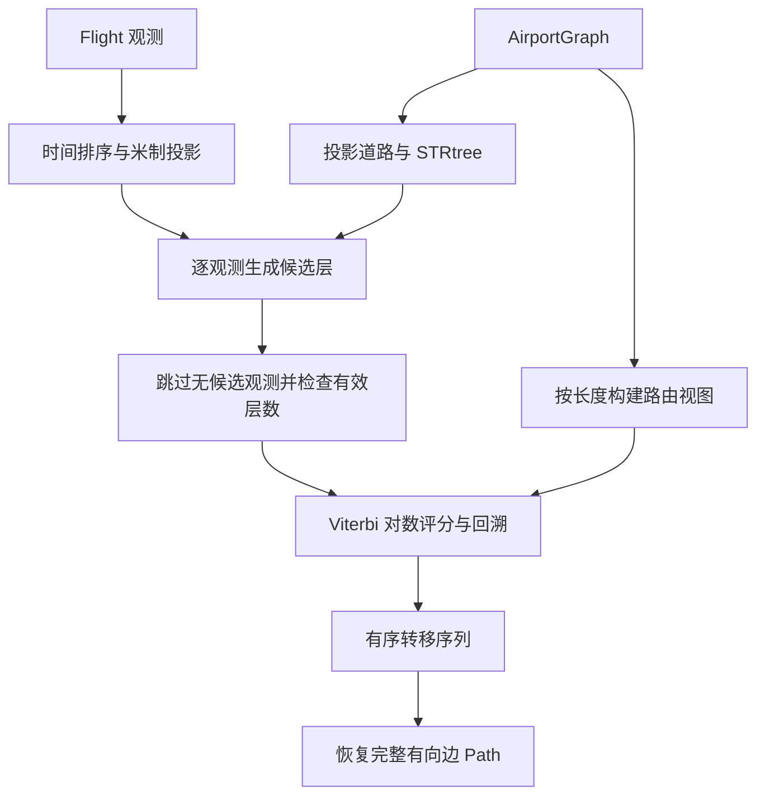

# path_map 路径匹配原理与内部实现

本文说明项目自有 AirportGraph 上的距离型 HMM 路径匹配：候选如何形成、候选之间如何沿网移动、Viterbi 如何选择状态序列，以及状态序列如何恢复为有向路径。具体调用方式见 [模块使用说明](../src/path_map/README.md)，机场图的结构与拓扑依据见 [AirportGraph 设计说明](airport_surface.md)。

## 1. 职责与前提

模块接收合法的 Flight 和 AirportGraph，在观测位置与机场道路之间寻找一致的路径解释。机场图在 Matcher 生命周期内应保持不变；空间索引、道路长度和路由视图都在初始化时建立，不随外部修改自动更新。

匹配过程信任输入模型，不承担机场拓扑修复、航班清洗或道路运行规则推断。它处理的是无向网络上的距离关系，返回的方向来自所选转移，而不是机场图的边方向。

成功表示：保留的观测在有限候选集合中存在一条可达、具有沿网移动的最优评分序列。它不证明所有输入观测均得到解释，也不等于有人工标注支持的真实滑行路线。

## 2. 内部结构

| 文件 | 职责 |
|---|---|
| `candidates.py` | 投影道路、空间索引、候选位置与里程。 |
| `hmm.py` | 路由视图、候选转移、观测与转移评分、Viterbi 解码。 |
| `matcher.py` | 配置、逐航班流程、有效观测筛选、路径恢复及批量结果。 |
| `path.py` | 有向边序列、顺序几何、完整边长度及持久化关联。 |
| `data.py` | 航班数据加载与进出港标签；该标签不参与当前评分。 |

## 3. 候选状态的形成

CandidateIndex 将每条道路投影到机场图指定的米制坐标系，并将曲线定向为从索引记录的节点 u 指向 v。空曲线和零长度曲线不进入候选索引。所有有效投影曲线共同构建 STRtree。

每个 Candidate 保存：

| 字段 | 语义 |
|---|---|
| `observation_index` | 原始投影观测序列中的索引，跳过观测后可能不连续。 |
| `edge_id` | `(u, v, key)`，保留平行边身份。 |
| `distance` | 观测点到候选曲线的米制距离。 |
| `point` | 观测点在曲线上的最近投影位置。 |
| `offset` | 从定向曲线起点到候选位置的累计米制距离。 |
| `fraction` | `offset / edge_length`。 |

空间查询先使用观测点的缓冲区域筛选相交曲线，再计算精确的点到曲线距离，按距离排序并截取候选数量上限。每条边在一个观测层中最多提供一个最近投影候选。

初始半径内没有候选时，半径逐次加倍，但不超过最大半径。一旦已有候选就停止扩大；不会因后续不连通而重新扩展搜索。达到上限仍没有候选的观测被跳过，其余观测按原时间顺序组成新的相邻层。

进入 Viterbi 前必须至少保留两个候选层。保留点数和跳过点数写入调试日志。当前不设置覆盖率阈值或连续缺口阈值。

## 4. 候选之间的网络转移

### 4.1 节点路由视图

NetworkRouter 为原始 MultiGraph 建立私有的无向简单图。连接相同端点的多条边中，只保留长度最短的一条用于中间节点路由，并记录原边 key。

这种压缩适用于当前只按距离计算的中间最短路；候选仍保留自己的完整边身份，源端和目标端的部分边距离也仍按各自道路计算。它不适用于需要区分道路语义或通行方向的扩展模型。

路由视图被冻结以防意外修改，节点之间通过 NetworkX 带长度权重的最短路连接。实现不缓存端点对的最短路结果。

### 4.2 转移方案枚举

设源候选位于边 `(u, v)` 的里程 s，边长 Ls；目标候选位于 `(a, b)` 的里程 t，边长 Lt。

源候选有两个出口：到 u 的距离为 s，到 v 的距离为 Ls−s。目标候选有两个入口：从 a 到候选的距离为 t，从 b 到候选的距离为 Lt−t。

四种端点组合分别计算：

$$
D_{x,y} = d_{\mathrm{source}\to x} + d_G(x,y) + d_{y\to\mathrm{target}}
$$

其中 x 为源边出口，y 为目标边入口，\(d_G(x,y)\) 为两节点之间的最短沿网距离。

若两候选在同一条索引边上，还加入沿边直接移动的方案：

$$
D_{\mathrm{direct}} = |t-s|
$$

同边直达不会提前返回，仍与端点绕行竞争，从而允许经其他道路形成更短的路线。

从所有可达方案中选择距离最小者；没有可达方案时返回 `None`。这与“可达但评分很低”是两个不同状态。

### 4.3 距离与边序列

Transition 同时保存精确到候选位置的沿网距离，以及该方案经过的有向完整边标识。源、目标的部分边只用于距离计算；输出 Path 不截断这两条边。

零距离转移具有空边序列，不能凭边存储方向制造一次行驶。端点方案中距离为零的源侧、目标侧部分边也不加入边序列。数值零使用 `1e-9 m` 容差，不是判定飞机停留的业务速度阈值。

## 5. HMM 评分与 Viterbi

每个观测层的隐藏状态是该观测的道路投影候选。设候选到观测的距离为 d，观测误差参数为 σ，观测对数得分为：

$$
E(d) = -\frac{d^2}{2\sigma^2} - \log\left(\sigma\sqrt{2\pi}\right)
$$

设相邻候选的最短沿网距离为 D，相邻保留观测的投影直线距离为 r，转移参数为 β：

$$
T(D,r) = -\frac{|D-r|}{\beta}
$$

转移评分省略了对所有候选序列相同的归一化常数，不影响固定参数下的最优序列选择。时间戳只用于排序，不参与距离惩罚；跳过观测后，r 直接由相邻保留观测计算。

Viterbi 在对数空间累计分数：第一层使用观测得分；后续每个候选遍历上一层可达候选，取“上一层累计分数＋转移得分＋本层观测得分”的最大值，并记录前驱及转移。

上一层得分为负无穷的状态不参与扩展。最终不存在可达状态时报告不连通；否则从最高分状态回溯，反转回溯结果，恢复按时间排序的候选和转移序列。并列最优时选择遍历中先遇到的方案，不承诺唯一的物理解释。

Viterbi 得到的是候选集合和当前评分模型内的全局最优，而非所有可能道路位置上的全局最优。候选数量限制和搜索半径会影响可选解空间。

## 6. 从转移恢复 Path

路径恢复按时间顺序连接各 Transition 的边序列：空转移不增加边；相邻非空转移若在同一条同方向边上继续前进，仅合并边界处的一次重复。

不能对整个路径做集合去重。反向边、绕环后的再次经过，以及一次转移内部的重复遍历都必须保留。重复位置不会增加行驶，而真正的方向反转仍应形成两段有向遍历。

若全部转移恢复后没有边，则报告无法确定有向路径，而不是任意选择一个方向。

Path 保存机场图引用和有序 DirectedEdge 元组。每条 DirectedEdge 使用 `(from_, to_, key_)` 指定方向与平行边。构造时检查边存在、相邻边首尾相接，并拒绝无法表达方向的自环边。

`geometry` 将各边调整到遍历方向后按顺序拼接，省略相邻片段的重复连接坐标，不使用几何合并操作重新排列。这样闭环起点、折返与重复经过的顺序保持不变。

`total_length` 累计完整图边长度，重复经过重复计入。它不等于 Transition 的候选间距离之和，也不是观测起点到终点之间精确裁剪的滑行长度。

## 7. 失败边界与配置

| 情况 | 当前处理 |
|---|---|
| 原始有效观测不足两个 | `MapMatchingError`。 |
| 跳过无候选观测后不足两个候选层 | `MapMatchingError`。 |
| 返回的候选集合中出现自环边 | 明确报告当前不支持自环匹配，不尝试猜测方向。 |
| 不存在贯穿候选层的可达序列 | `MapMatchingError`。 |
| 所选候选序列没有沿网移动 | `MapMatchingError`。 |
| 非预期程序异常 | 不统一转换为正常匹配失败。 |

自环是同一节点连接自身的单条边；由多个不同节点组成的闭环路径不属于该限制。

MatchConfig 检查距离参数有限且为正，最大半径不小于初始半径，候选数为正整数且不是布尔值。默认初始半径为 40 米、最大半径为 120 米、候选数为 40、σ 为 10 米、β 为 20 米；它们是默认模型参数，不是准确率承诺。

批量入口复用同一个 Matcher，对每条航班独立执行匹配，将成功的 `(flight_id, Path)` 和正常失败的原因分别收集。它不将一条航班的正常匹配失败传播为整批失败。

## 8. 持久化、效率与适用边界

PathRecord 只保存机场图内容标识和有向边序列。解析时检查目标图的内容标识，再构造 Path。它不保存 HMM 候选、评分、观测过滤诊断或图副本。

候选索引和路由视图在 Matcher 初始化时建立。设保留观测数为 N、每层最多 K 个候选，候选转移计算次数上界为：

$$
C_{\mathrm{transition}} \le (N-1)K^2
$$

每次转移最多请求四次中间最短路。运行开销还取决于路由图规模。当前保留直接、可读的实现，不引入路由缓存或并行求解。

模型未使用航向、速度、单行规则、跑道和滑行道业务限制、逐点变化的不确定度或时间缺口分段。它也不对有候选的异常点进行自动修复。无向距离评分可能给出多种相近解释，成功状态不能作为实际运行路线的独立认证。

正确性验证应分别覆盖候选转移的独立插点最短路参照、Viterbi 与穷举分数的一致性、零位移和真实折返、端点零长度片段、路径顺序及持久化。真实数据运行用于验证集成行为；缺少标注时不据此推断匹配准确率。
